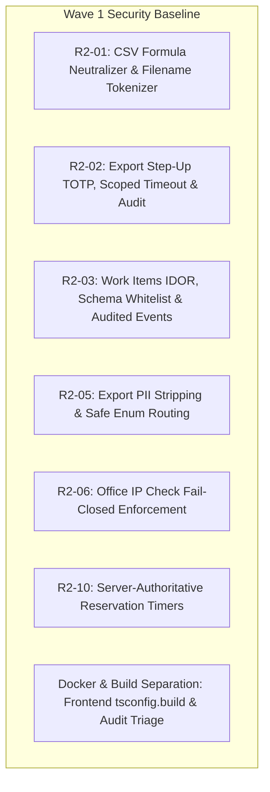

# Udigity HR & Operations Management System
## Master Implementation Plan: Wave 1 Security Baseline, Break Management, and Dynamic RBAC (v2.1)

**Document Reference:** `docs/implementation/master-implementation-plan-v2.md`  
**Status:** Wave 1 Authorized — Phased Approval Gated  
**Author:** Senior Full-Stack & Systems Architect  
**Date:** 2026-10-26  
**Standards:** Zero AI-Slop, Strict Enterprise Security, Production-Grade TypeScript/PostgreSQL  

---

## 1. Executive Summary & Phasing Strategy

Per Owner authorization, implementation is strictly phased:
- **Phase 1 (Authorized for Immediate Execution)**: **Wave 1 Security Baseline & Build Hardening**.
- **Phase 2 (Requires Wave 1 Sign-Off Before Starting)**: **Wave 2 Attendance Break Lifecycle**.
- **Phase 3 (Requires Wave 2 Sign-Off Before Starting)**: **Wave 3 Dynamic Custom Roles & Enterprise RBAC**.

At the conclusion of Wave 1, a comprehensive handover report including all changed files, executed commands, test outputs, residual risk assessment, and Docker Desktop multi-container verification will be presented. No Wave 2 or 3 code will be executed without prior written approval.

---

## 2. Wave 1: Security Baseline & Build Hardening (Authorized Scope)

Wave 1 incorporates all P1 High-Priority findings and promoted P2 security controls into a unified security baseline.



### 2.1 R2-01: CSV Formula Injection Neutralization & Filename Sanitization
- **Vulnerability:** Unsanitized user inputs (e.g. business names, notes) beginning with formula triggers (`=`, `+`, `-`, `@`, `\t`, `\r`) execute arbitrary commands when opened in desktop spreadsheet software (Excel, LibreOffice).
- **Implementation:**
  1. `backend/src/modules/reports/service.ts`: Update `escapeCsvField(raw: string)`:
     - Trim leading whitespace.
     - If the value begins with `=`, `+`, `-`, `@`, `\t`, or `\r`, prepend an apostrophe (`'`).
     - Quote the entire field and escape embedded double quotes (`""`).
  2. **Workflow Documentation & Limitations:**
     - The leading `'` forces Excel/Google Sheets to parse the field strictly as a string literal.
     - When saving back from Excel, the apostrophe remains part of the text data. This is documented for operators in the export modal.
  3. **Filename Tokenizer:**
     - Restrict the `report` parameter in `Content-Disposition` to `^[a-z0-9_-]{1,60}$`. Any non-conforming identifier is rejected with HTTP 400.
  4. **Automated Verification:**
     - Test suite verifies formula payloads: `=HYPERLINK("http://attacker.com")`, `-2+3|cmd`, `@SUM(A1:A10)`, `\t=1+1`.

### 2.2 R2-02 & R2-05: Session-Bound Export Step-Up, Scoped Timeouts & PII Stripping
- **Vulnerability:** `report.export` dumps sensitive timesheets and directory data without recent 2FA re-authentication, lacks query execution timeouts, emits no denial/failure audit trails, and includes unnecessary PII (employee emails).
- **Implementation:**
  1. **Session-Bound Step-Up Verification:**
     - Use migration `013_identity_session_step_up.sql` (`sessions.step_up_at TIMESTAMPTZ`).
     - Implement middleware `requireRecentTotp(maxAgeMinutes = 10)`:
       - Inspects `req.session.stepUpAt`.
       - If `null` or older than 10 minutes, returns HTTP 403 with `STEP_UP_REQUIRED`.
       - Step-up is strictly session-bound and cannot be transferred across devices or tokens.
     - Implement `POST /api/auth/2fa/step-up` requiring valid TOTP code; sets `step_up_at = CURRENT_TIMESTAMP` on the active session.
  2. **Scoped Query Timeouts & Cancellation:**
     - Run export queries inside a dedicated transaction block with `SET LOCAL statement_timeout = '30000'` (30-second cap).
     - Handle client disconnect: If the HTTP request closes prematurely, rollback the transaction and abort streaming.
  3. **Rate Limiting & Audit Logging:**
     - Apply per-user rate limit: maximum 5 exports per 10 minutes.
     - Audit all terminal states:
       - `report.exported`: Successful stream (records `reportType`, `format`, `rowCount`, `filters`, `exportId`).
       - `report.export_denied`: Denied access or expired step-up (records `reportType`, `actorId`, `reason`).
       - `report.export_failed`: Timeout or database error (records `reportType`, `errorCode`).
  4. **R2-05 PII Stripping & Safe Enum Routing:**
     - Remove `email` from timesheet export (`rep-1`). Only include `employeeId`, `fullName`, `department`, and attendance metrics.
     - Replace loose default branch with strict Zod enum: `z.enum(['attendance_summary', 'attendance_timesheet', 'calling_activity', 'deals_pipeline'])`. Any unknown report type returns HTTP 400.
     - Validate `from` and `to` filters as ISO dates (`z.string().date()`).

### 2.3 R2-03: Work Items IDOR Remediation & Allowed-Field Whitelisting
- **Vulnerability:** `PATCH /api/work-items/:id` was checked only by `target.read` without verifying ownership or assigning authority, allowing any user to edit colleagues' items without auditing.
- **Implementation:**
  1. **Matrix Action & Route Protection:**
     - Declare `work_item.update` in `backend/src/modules/access/matrix.ts` (`roles: [owner, data_entry, call_center, developer]`, scope: `Own` / `Owner`).
     - Mount `requireAction('work_item.update')` on `PATCH /api/work-items/:id`.
  2. **Resource-Level Authorization:**
     - Load target item with `SELECT * FROM work_items WHERE id = $1 FOR UPDATE`.
     - If not found: return HTTP 404.
     - If caller is not `owner` AND `item.assignee_id !== caller.employeeId`: return HTTP 404 (preventing IDOR existence probing).
  3. **Allowed-Field Whitelisting:**
     - Schema `.strict()` allowing only mutable fields: `status` (`open`, `in_progress`, `completed`, `cancelled`), `notes`.
     - Forbid mutation of `id`, `assigneeId`, `sourceType`, `sourceId`, `createdAt`.
  4. **Audited Event:**
     - Write `work_item.updated` to `audit_events` in the same transaction.
  5. **Automated Tests:**
     - Test Owner can update any work item.
     - Test Assignee can update their own work item.
     - Test User B cannot update User A's work item (assert HTTP 404 and zero audit modification).

### 2.4 R2-06: Office IP Check Fail-Closed Enforcement
- **Vulnerability:** When attendance settings were unconfigured or empty, `checkIn` evaluated to `not_configured` and allowed the session to proceed.
- **Implementation:**
  - In `backend/src/modules/attendance/service.ts`:
    - If `verification_mode === 'ip'` and `office_ips` is empty or unconfigured:
      - Reject check-in immediately with HTTP 409 `POLICY_NOT_CONFIGURED`, unless an active approved `remote_exceptions` record exists for the employee.
    - Add explicit test case verifying check-in failure when office IP list is unconfigured.

### 2.5 R2-10: Server-Authoritative Reservation Timers
- **Vulnerability:** Reservation heartbeat accepted client-provided `idleSeconds` and client `keepWorking` flags without server-side validation.
- **Implementation:**
  - Disregard client-supplied timing values in `reservation.service.ts`.
  - Calculate elapsed time strictly using `EXTRACT(EPOCH FROM (CURRENT_TIMESTAMP - last_touchpoint_at))`.
  - Cap maximum single-reservation duration at 60 minutes (`POLICY_RESERVATION_MAX_MINUTES`).

### 2.6 Docker Build/Runtime Separation & Dependency Hygiene
- **Frontend Docker Build Blocker:**
  - In `frontend/`: Create `tsconfig.build.json`:
    ```json
    {
      "extends": "./tsconfig.json",
      "exclude": ["node_modules", "**/*.test.ts", "**/*.test.tsx", "src/fixtures/**"]
    }
    ```
  - Update `frontend/package.json`: `"build": "next build"` uses production config; keep separate test config for Vitest to maintain 100% typecheck coverage.
- **Dependency Security Review:**
  - Run targeted `npm audit fix` for `body-parser`.
  - Review `zod` advisory; ensure compatibility across all schemas.

---

## 3. Wave 2: Attendance Break Lifecycle Specification (Design Freeze)

*Execution locked until Wave 1 sign-off.*

### 3.1 Migration Identifier
- Migration: `021_attendance_breaks.sql` (in BE1 range `010–099`).

### 3.2 Formal Business & Operating Rules
1. **Compensation:** Breaks are classified as `unpaid` (deducted from 9-hour workday calculation) or `paid` (short pauses $\le 15$ min).
2. **Daily Limits:** Maximum cumulative break time per 9-hour shift is 60 minutes. Exceeding 60 minutes flags the session as `excessive_breaks` for supervisor review.
3. **Checkout During Break:** If an employee attempts to check out while an active break is running:
   - System automatically finalizes the active break with `ended_at = check_out_at`.
   - Records checkout normally with an audit flag `break_auto_closed`.
4. **Forgotten Breaks:** If an active break exceeds 180 minutes without user activity or check-out, the background scheduler (`J-04`) flags the break as `orphaned_break` and alerts the Owner.
5. **Corrections:** Employees can submit break correction requests (`attendance.correction.request`), reviewed and approved by the Owner.
6. **Concurrency Guarantee:** A partial unique index `(session_id) WHERE ended_at IS NULL` guarantees that no employee can have more than one simultaneous active break.

---

## 4. Wave 3: Dynamic Custom Roles & Enterprise RBAC (Design Freeze)

*Execution locked until Wave 2 sign-off.*

### 4.1 Migration Identifier
- Migration: `014_dynamic_roles_rbac.sql` (in BE1 range `010–099`).

### 4.2 Architectural Safeguards
1. **Preservation of Contextual Scopes:**
   - RBAC rules support 4 data scopes: `self`, `department`, `global`, and `assigned_only`.
   - Contextual logic (e.g. Call Center lead assignment leases, Developer deal assignment) is preserved and cannot be bypassed by custom roles.
2. **Privilege Escalation Prevention:**
   - Custom roles cannot grant administrative actions (`admin: true`) unless created by an active Owner with verified step-up 2FA.
   - A non-owner with user-management permissions cannot elevate themselves or another user to `owner`.
3. **Protection of the Last Owner:**
   - The database enforces that the role `owner` cannot be deleted, and the last active user with the `owner` role cannot be deactivated or reassigned.
4. **Guaranteed Session Invalidation:**
   - Whenever an Owner modifies a role's permissions, `endRoleSessions(roleId)` revokes all active sessions for that role in PostgreSQL. The frontend intercepts the revoked session and prompts the user to re-authenticate with updated capabilities.

---

## 5. Wave 1 Verification Gates & Deliverables

At the conclusion of Wave 1, the following artifacts and evidence will be provided:
1. **Detailed File Diff**: Every modified file across backend and frontend.
2. **Applied Migrations**: Status of database schema.
3. **Command Execution Log**: Exact commands run.
4. **Automated Test Results**: Vitest output demonstrating 100% pass rate, including newly introduced security regression tests.
5. **Docker Desktop Verification**: Proof of healthy execution for all 4 containers (`udigity-db`, `udigity-backend`, `udigity-worker`, `udigity-frontend`).
6. **Residual Risk Assessment**: Updated status of all 14 P2 findings.
