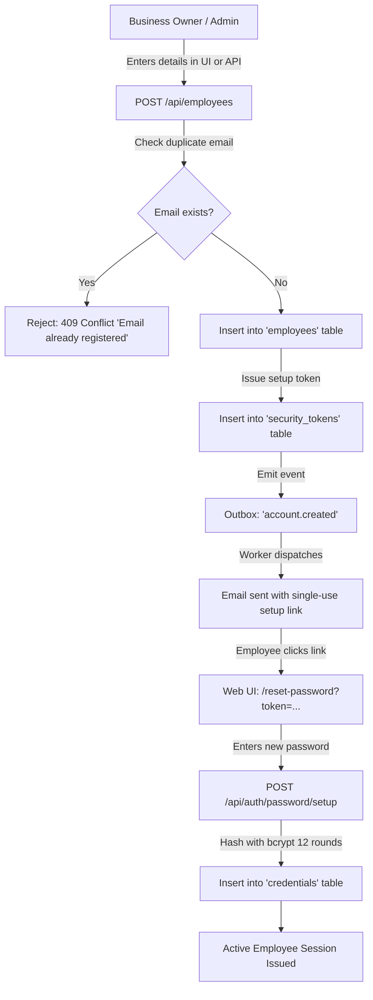
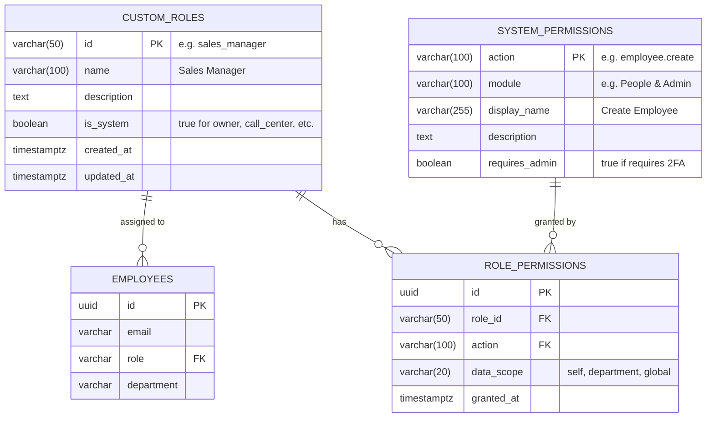
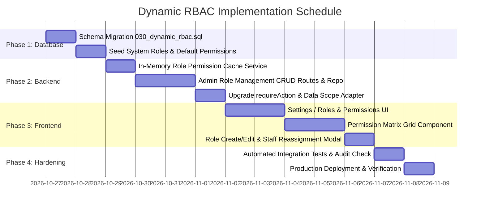

# Udigity HR & Operations Management System
## User Management, Role Authorization Architecture, and Dynamic Custom Roles Plan

**Document Version:** 1.0.0  
**Target Audience:** Business Owner, Lead Architect, Full-Stack Engineering Team  
**Design Standard:** Enterprise Production-Ready, Zero AI-Slop  
**Classification:** Proprietary / System Architecture & Implementation Plan  

---

## 1. Executive Summary

This document provides a comprehensive operational guide and engineering specification for user provisioning, access control, and dynamic role customization in the Udigity Management System.

The platform currently operates on a **Capability-Driven Role-Based Access Control (RBAC)** architecture. While permissions are enforced dynamically per action on both the Express backend (`requireAction`) and Next.js frontend (`useCapabilityCheck`), the roles themselves (`owner`, `call_center`, `data_entry`, `developer`) are currently constrained by a PostgreSQL check constraint and static matrix mappings.

This document delivers:
1. **Operational Guide**: Exactly how to create, invite, manage, and provision users across environments.
2. **Role Deep-Dive**: Complete breakdown of what every role does, how their daily workflows function, and their exact operational boundaries across all 10 system modules.
3. **Dynamic Custom Roles Implementation Plan**: The architectural blueprint allowing the Business Owner to create custom roles (e.g., *Sales Manager*, *HR Specialist*, *Team Lead*, *Accountant*) and graphically configure granular access to pages, data scopes, and business actions.
4. **Zero AI-Slop Guidelines**: Explicit engineering standards ensuring that UI copy, validation states, alerts, error responses, and audit logs maintain dignified, enterprise-grade clarity without generic AI conversational fluff.

---

## 2. Part 1: How User Management & Provisioning Works Today

User onboarding follows strict security controls (threat model `AU-8`, `AU-9`, `SE-4`). Users are never created with insecure plaintext passwords sent over unencrypted channels, and the Business Owner never has access to view another employee's password.



### 2.1 The Three Methods for Adding Users

#### Method A: Via Web UI (Owner Admin Dashboard) — Production Standard
1. Sign in as the **Owner**.
2. Navigate to **People & Admin > Employees** (`/employees`) in the sidebar.
3. Click the **"Add Employee"** button at the top right of the directory.
4. Fill in the employee profile:
   - **Full Name** (e.g., `Maya Khoury`)
   - **Work Email** (must be unique, e.g., `maya.khoury@udigity.com`)
   - **Role Assignment**: Select from `Call Center`, `Data Entry`, `Developer`, or `Owner`.
   - **Department** (e.g., `Sales`, `Operations`, `Engineering`, `Executive`)
   - **Job Title** (e.g., `Senior Outreach Representative`)
   - **Phone Number** (e.g., `+961 70 123 456`)
5. Submit the form:
   - The backend validates the payload with Zod schema (`CreateEmployeeSchema`).
   - Generates an employee record with `is_active: true`.
   - Issues a secure, single-use credential setup token valid for 24 hours.
   - Dispatches a welcome invitation email via the outbox worker containing the setup link.
   - Records an immutable audit log: `account.created` with the Owner's actor ID.

#### Method B: Via Server CLI Bootstrap (`npm run owner:bootstrap`) — Operator / Recovery
Used to provision the very first Business Owner or perform disaster recovery when an Owner loses their 2FA device and recovery codes:
```bash
# Provision first Owner on a fresh instance
npm run owner:bootstrap --workspace=backend -- --email owner@udigity.com --name "Business Owner"

# Terminal Output (Displayed ONCE, never logged to disk):
# Owner created. Temporary password (shown once): aB9_xK2...
# 2FA enrollment token (shown once, single use, expires 2026-10-27T12:00:00Z): tok_sec_...
```

#### Method C: Via Seed Script (`npm run seed`) — Local Dev & Demo Testing
For rapid testing and UI validation, the project includes an automated seed script that creates 6 standard demo accounts across all departments:
```bash
npm run seed --workspace=backend
```
| Full Name | Email | Role | Department | Default Password | 2FA Enrolled |
| :--- | :--- | :--- | :--- | :--- | :--- |
| **Rana Haddad** | `rana.haddad@udigity.demo` | `owner` | Executive | `Password123!` | Enrolled (`JBSWY3DPEHPK3PXP`) |
| **Karim Saleh** | `karim.saleh@udigity.demo` | `data_entry` | Operations | `Password123!` | None |
| **Maya Khoury** | `maya.khoury@udigity.demo` | `call_center` | Sales | `Password123!` | None |
| **Omar Nassar** | `omar.nassar@udigity.demo` | `call_center` | Sales | `Password123!` | None |
| **Lina Aoun** | `lina.aoun@udigity.demo` | `developer` | Engineering | `Password123!` | None |
| **Sami Fares** | `sami.fares@udigity.demo` | `developer` | Engineering | `Password123!` | None |

---

## 3. Part 2: Complete Review of Existing Roles & Permissions

The system enforces a strict principle of least privilege. The table below details what each role can access, interact with, edit, and view.

### 3.1 Role 1: Business Owner (`owner`)
*The Managing Director / Super Admin. Oversees the entire business lifecycle from staff management to financial delivery and security.*

- **Daily Workflow & Responsibility:**
  - Monitors high-level business health via **Dashboard**, **Delivery Monitor**, and **Attendance Monitor**.
  - Manages workforce roster: creates employees, modifies job titles/departments, changes roles, and deactivates accounts.
  - Reviews and acts upon staff correction requests, remote attendance exceptions, and missed checkouts.
  - Oversees sales outreach: configures calling quotas, assigns leads to call center agents, and reviews converted opportunities.
  - Approves closed deals, verifies contracts/payments, and monitors technical delivery progress.
  - Accesses audit logs and exports executive CSV reports with step-up 2FA re-verification.
- **Attendance Mandate:**
  - Required to check in and out daily like all staff (no exemption per policy `F-04`), reinforcing company culture and accountability.
- **Key Modules & Access:**
  - `Full Access`: All 10 modules, all routes, all data scopes (Company-Wide).

---

### 3.2 Role 2: Call Center Specialist (`call_center`)
*Outreach Representative. Dedicated to calling leads, booking discovery meetings, and qualifying prospects.*

- **Daily Workflow & Responsibility:**
  - Opens **My Day** (`/my-day`) to review daily targets (calls logged, meetings booked).
  - Clocks in via **My Attendance** (`/my-attendance`) with IP verification.
  - Navigates to **Calling Queue** (`/queue`):
    - Claims the next assigned business lead.
    - An exclusive 15-minute lease token (`reservation.acquire`) locks the record to prevent other callers from dialing simultaneously.
    - Dials the contact number.
    - Logs call attempt outcome: *Interested*, *Not Interested*, *Call Back*, *Gatekeeper Rejection*, or *Invalid Number*.
  - If prospect requests a callback: sets date and time in **Follow-ups & Calendar** (`/calendar`).
  - If prospect is qualified: converts lead to a Deal, sets budget/scope notes, and schedules an initial technical discovery meeting with a Developer.
  - If business requests removal: flags business as *Do Not Call* (`/do-not-call`).
- **Data Scopes & Restrictions:**
  - `Queue Access`: Scoped strictly to leads assigned to them.
  - `Master Data`: Cannot directly edit master business records; must submit a **Data Correction Request** to Data Entry if a phone number or address is incorrect.
  - `Restricted From`: Employee directory, system settings, company revenue/reports, delivery codeboards, audit trails.

---

### 3.3 Role 3: Data Entry Specialist (`data_entry`)
*Master Data Gatekeeper. Ensures directory hygiene, deduplication, and accuracy of business profiles.*

- **Daily Workflow & Responsibility:**
  - Clocks in via **My Attendance**.
  - Adds new company leads via **Add Business** (`/businesses/new`).
    - Enters business name, category, phone, mobile, address, website, and social links.
    - System executes real-time duplicate check against phone numbers, names, and websites before allowing submission.
  - Manages **Correction Requests Queue** (`/corrections`):
    - Reviews data corrections submitted by Call Center or Developers (e.g., "Phone disconnected, use secondary mobile").
    - Verifies the evidence, applies changes directly to the master directory, or rejects with an audited explanation.
  - Reviews and maintains business categories (`/categories`).
- **Data Scopes & Restrictions:**
  - `Master Data`: Full create and edit access to `businesses` and `categories`.
  - `Restricted From`: Calling queues, client deals, contracts, meetings, developer taskboards, employee records, financial reports.

---

### 3.4 Role 4: Developer (`developer`)
*Delivery Engineer & Technical Consultant. Scopes client requirements, attends deal meetings, signs agreements, and delivers software projects.*

- **Daily Workflow & Responsibility:**
  - Clocks in via **My Attendance**.
  - Attends discovery meetings booked by Call Center via **Meetings Calendar** (`/meetings`).
  - Evaluates client technical needs and updates deal progress in **Deals Pipeline** (`/deals`).
  - Once client agrees: records contract signature and payment milestone in the system, then requests deal closure verification from the Business Owner.
  - In **Projects** (`/projects`):
    - Works on active client delivery boards.
    - Creates, updates, and completes development tasks across Kanban swimlanes (*To Do*, *In Progress*, *In Review*, *Done*).
  - Submits correction requests to Data Entry if company details need updating.
- **Data Scopes & Restrictions:**
  - `Deals & Projects`: Access is restricted to deals and projects assigned to them.
  - `Restricted From`: Unassigned deals, employee records, cold calling queue, company settings, audit logs, global exports.

---

### 3.5 Granular Cross-Role Permission Matrix

| Module / Action | Owner | Call Center | Data Entry | Developer | Scope Restriction |
| :--- | :---: | :---: | :---: | :---: | :--- |
| **Self Profile & Password** | Yes | Yes | Yes | Yes | Self Only |
| **Clock In / Clock Out** | Yes | Yes | Yes | Yes | Self Only (Office IP verified) |
| **Request Attendance Correction** | Yes | Yes | Yes | Yes | Self Only |
| **Review Attendance Corrections** | Yes | No | No | No | Owner Only |
| **Employee Directory (View/Add/Edit)** | Yes | No | No | No | Owner Only |
| **Deactivate Employee** | Yes | No | No | No | Owner Only (Cannot self-deactivate) |
| **Business Directory (Search/Read)** | Yes | Yes | Yes | Yes | Scoped by assignment / context |
| **Business Directory (Create/Edit)** | Yes | No | Yes | No | Owner & Data Entry Only |
| **Submit Data Correction** | Yes | Yes | No | Yes | Data Entry edits directly |
| **Apply/Reject Data Correction** | Yes | No | Yes | No | Data Entry & Owner Queue |
| **Calling Queue (Dial & Log)** | Yes | Yes | No | No | Assigned Leads Only |
| **Assign Leads to Callers** | Yes | No | No | No | Owner Only |
| **Schedule Discovery Meeting** | Yes | Yes | No | Yes | Assigned Deals Only |
| **Update Deal Stage & Payment** | Yes | No | No | Yes | Assigned Developer & Owner |
| **Verify & Finalize Deal Closure** | Yes | No | No | No | Owner Only |
| **Project Boards & Task Management** | Yes | No | No | Yes | Assigned Projects Only |
| **Company Targets & Quotas** | Yes | View Own | No | View Own | Owner sets; Staff view own targets |
| **Audit Logs & Security Events** | Yes | No | No | No | Owner Only (Immutable) |
| **Executive Reports & CSV Stream** | Yes | No | No | No | Owner Only (Step-up 2FA re-auth) |
| **System Settings & Policies** | Yes | No | No | No | Owner Only |

---

## 4. Part 3: Dynamic Custom Roles & Granular Permission Matrix (Implementation Plan)

### 4.1 Objective
Empower the Business Owner to create custom roles (e.g., `sales_manager`, `hr_officer`, `team_lead`, `financial_controller`) and customize their exact access matrix via an intuitive UI without writing any code or modifying database migrations.

### 4.2 Database Architecture



#### Migration: Schema Upgrades (`backend/src/db/migrations/030_dynamic_rbac.sql`)

```sql
-- 1. Create table of custom roles
CREATE TABLE IF NOT EXISTS roles (
  id VARCHAR(50) PRIMARY KEY,
  name VARCHAR(100) NOT NULL,
  description TEXT,
  is_system BOOLEAN NOT NULL DEFAULT false,
  created_at TIMESTAMPTZ NOT NULL DEFAULT CURRENT_TIMESTAMP,
  updated_at TIMESTAMPTZ NOT NULL DEFAULT CURRENT_TIMESTAMP
);

-- Seed existing system roles
INSERT INTO roles (id, name, description, is_system) VALUES
  ('owner', 'Business Owner', 'Full unrestricted company-wide access and administration.', true),
  ('call_center', 'Call Center Specialist', 'Cold outreach, call logging, and lead reservation.', true),
  ('data_entry', 'Data Entry Specialist', 'Business directory management and data corrections.', true),
  ('developer', 'Software Engineer', 'Deal scoping, client delivery, and technical execution.', true)
ON CONFLICT (id) DO NOTHING;

-- 2. Create catalog of granular actions
CREATE TABLE IF NOT EXISTS permissions (
  action VARCHAR(100) PRIMARY KEY,
  module VARCHAR(100) NOT NULL,
  display_name VARCHAR(255) NOT NULL,
  description TEXT,
  requires_admin BOOLEAN NOT NULL DEFAULT false
);

-- 3. Create role-to-permission mapping table with data scope
CREATE TABLE IF NOT EXISTS role_permissions (
  id UUID PRIMARY KEY DEFAULT gen_random_uuid(),
  role_id VARCHAR(50) NOT NULL REFERENCES roles(id) ON DELETE CASCADE,
  action VARCHAR(100) NOT NULL REFERENCES permissions(action) ON DELETE CASCADE,
  data_scope VARCHAR(20) NOT NULL DEFAULT 'global' CHECK (data_scope IN ('self', 'department', 'global')),
  created_at TIMESTAMPTZ NOT NULL DEFAULT CURRENT_TIMESTAMP,
  UNIQUE(role_id, action)
);

CREATE INDEX IF NOT EXISTS idx_role_permissions_role ON role_permissions(role_id);

-- 4. Upgrade employees table constraint to reference roles table
ALTER TABLE employees DROP CONSTRAINT IF EXISTS employees_role_check;
ALTER TABLE employees ADD CONSTRAINT fk_employees_role FOREIGN KEY (role) REFERENCES roles(id) ON UPDATE CASCADE ON DELETE RESTRICT;
```

---

### 4.3 Backend Service & Dynamic Authorization Engine

#### 1. In-Memory Permission Cache (`backend/src/modules/access/dynamicService.ts`)
To maintain sub-millisecond API response times and zero database overhead on every HTTP request, role permissions are cached in-memory with automatic cache invalidation upon any role update:

```typescript
interface CachedPermission {
  actions: Set<string>;
  dataScopes: Map<string, 'self' | 'department' | 'global'>;
}

class RolePermissionCache {
  private cache = new Map<string, CachedPermission>();
  private lastLoaded = 0;
  private readonly TTL_MS = 60_000; // 1 minute auto-refresh fallback

  async getRolePermissions(db: Queryable, role: string): Promise<CachedPermission> {
    const now = Date.now();
    if (!this.cache.has(role) || now - this.lastLoaded > this.TTL_MS) {
      await this.refresh(db);
    }
    return this.cache.get(role) ?? { actions: new Set(), dataScopes: new Map() };
  }

  async refresh(db: Queryable): Promise<void> {
    const { rows } = await db.query<{ role_id: string; action: string; data_scope: 'self' | 'department' | 'global' }>(
      `SELECT role_id, action, data_scope FROM role_permissions`
    );
    const newCache = new Map<string, CachedPermission>();
    for (const r of rows) {
      if (!newCache.has(r.role_id)) {
        newCache.set(r.role_id, { actions: new Set(), dataScopes: new Map() });
      }
      const entry = newCache.get(r.role_id)!;
      entry.actions.add(r.action);
      entry.dataScopes.set(r.action, r.data_scope);
    }
    this.cache = newCache;
    this.lastLoaded = Date.now();
  }

  invalidate(): void {
    this.lastLoaded = 0;
  }
}

export const rolePermissionCache = new RolePermissionCache();
```

#### 2. Dynamic Middleware Authorization Adapter
The existing middleware `requireAction(action)` in `backend/src/middleware/auth.ts` is upgraded:
1. It inspects `req.session.role`.
2. If `req.session.role === 'owner'`, full bypass is maintained for disaster recovery and system safety.
3. Otherwise, it queries `rolePermissionCache.getRolePermissions(pool, req.session.role)`:
   - If the action is present in `actions`: permission granted.
   - If missing: immediate, dignified `403 Forbidden` with problem detail:
     `{ type: "https://udigity.com/errors/forbidden", title: "Access Denied", status: 403, detail: "Your role does not have permission to execute this action." }`.
4. Attaches `req.dataScope` (`'self' | 'department' | 'global'`) to the request context so downstream SQL queries can filter records appropriately.

#### 3. Administrative Role Management Endpoints
Mounted on `backend/src/modules/admin/roles.routes.ts` (protected by `requireAction('settings.update')`):

- `GET /api/admin/roles`: List all roles (system + custom) with count of assigned employees.
- `POST /api/admin/roles`: Create a new custom role with name, description, and initial permissions.
- `GET /api/admin/roles/:id`: Retrieve single role details with its full permission matrix.
- `PATCH /api/admin/roles/:id`: Update role metadata, toggle actions, or modify data scopes. Invalidates permission cache and revokes active sessions for users with this role to enforce changes immediately.
- `DELETE /api/admin/roles/:id`: Deletes a custom role. Fails with `409 Conflict` if any active employees are assigned to it (must reassign staff first).

---

### 4.4 Frontend Architecture: Roles & Permissions Studio

#### 1. Navigation & Route
- Route: `/settings/roles` (nested inside Owner Settings).
- Sidebar link: **People & Admin > Settings > Roles & Permissions**.

#### 2. UI Layout & Component Hierarchy (Figma Tokens & Navy Dark Mode)

```
┌────────────────────────────────────────────────────────────────────────┐
│  Settings / Roles & Permissions                                        │
│  Manage system roles, configure dashboard visibility, and permissions. │
│                                                                        │
│  [System Roles]                                     [+ Create Custom Role]
│  ┌──────────────────────┬────────────────────────────────────────────┐ │
│  │ 🛡️ Business Owner   │ Role: Sales Manager                        │ │
│  │    Super Admin (1)   │ Description: Leads outreach and deals.    │ │
│  │ 📞 Call Center (2)   │ Assigned Members: 3 Active Employees       │ │
│  │ 📋 Data Entry (1)    │                                            │ │
│  │ 💻 Developer (2)     │ ────────────────────────────────────────── │ │
│  ├──────────────────────┤ Permissions Matrix                         │ │
│  │ [Custom Roles]       │                                            │ │
│  │ ⭐ Sales Manager (3) │ ▾ PEOPLE & EMPLOYEES                       │ │
│  │ ⭐ HR Officer (1)    │   [x] View Employee Directory              │ │
│  │                      │       Scope: [Department Only     ▼]       │ │
│  │                      │   [ ] Add / Edit Employees                 │ │
│  │                      │   [ ] Deactivate Employees                 │ │
│  │                      │                                            │ │
│  │                      │ ▾ CALLING & OUTREACH                       │ │
│  │                      │   [x] View Calling Queue                   │ │
│  │                      │       Scope: [Department Only     ▼]       │ │
│  │                      │   [x] Assign Leads to Callers              │ │
│  │                      │   [x] View Opportunities & Calendar        │ │
│  │                      │                                            │ │
│  │                      │ ▾ DEALS & DELIVERY                         │ │
│  │                      │   [x] View Pipeline Deals                  │ │
│  │                      │       Scope: [Company Wide        ▼]       │ │
│  │                      │   [x] Update Deal Status                   │ │
│  │                      │   [ ] Finalize Deal Closure                │ │
│  │                      │                                            │ │
│  │                      │ [Save Role Changes]       [Delete Role]    │ │
│  └──────────────────────┴────────────────────────────────────────────┘ │
└────────────────────────────────────────────────────────────────────────┘
```

#### 3. Client Capabilities Synchronization
When an employee signs in, `GET /api/auth/me` returns:
```json
{
  "user": {
    "id": "e817...",
    "email": "sarah.h@udigity.com",
    "fullName": "Sarah Haddad",
    "role": "sales_manager",
    "department": "Sales"
  },
  "capabilities": [
    "employee.list",
    "calling.queue.read",
    "calling.assign",
    "deal.read",
    "deal.update_stage"
  ]
}
```
The frontend sidebar (`frontend/src/lib/nav.ts`) automatically evaluates `capabilities` via `useCapabilityCheck()`. If a role has `employee.list` and `calling.assign` granted, the **Employees** and **Calling Assignments** links appear in their sidebar instantly; all unpermitted pages remain completely hidden from navigation and protected by route guards.

---

## 5. Part 4: Zero AI-Slop Standards & Engineering Guidelines

To guarantee the software remains clean, professional, and indistinguishable from handcrafted high-end software, the following rules are mandatory across the codebase:

### 5.1 No Conversational Fluff in UI Copy
- ❌ **AI Slop:** `"Oops! Looks like something went wrong on our end. Don't worry, our team of friendly engineers has been notified! Feel free to try again later."`
- ✅ **Enterprise Standard:** `"Failed to save changes. The database encountered a unique constraint violation on email address. Please verify the value and retry."`

- ❌ **AI Slop:** `"Great job! Your profile has been supercharged and updated successfully!"`
- ✅ **Enterprise Standard:** `"Profile updated successfully."`

- ❌ **AI Slop:** `"Hey there! It seems you don't have access to this magical page."`
- ✅ **Enterprise Standard:** `"Access denied. You do not possess the required permissions to view this section. Contact your administrator if you believe this is an error."`

### 5.2 Formal RFC-7807 Error Responses
Every API error must adhere to structured RFC-7807 specifications:
```json
{
  "type": "https://udigity.com/errors/insufficient-permissions",
  "title": "Forbidden",
  "status": 403,
  "detail": "Action 'employee.create' requires 'owner' or custom role with 'employee.create' entitlement.",
  "instance": "/api/employees"
}
```

### 5.3 Concrete Confirmation Dialogs
Destructive actions must never use generic "Are you sure?" modals. They must specify exact consequences:
- ❌ **AI Slop:** `"Are you sure you want to delete this role? This cannot be undone!"`
- ✅ **Enterprise Standard:** 
  - **Modal Title:** `"Delete Role: Sales Manager"`
  - **Body Content:** `"This action will unassign 3 active employees currently holding this role. You must reassign these employees to an active role before proceeding."`
  - **Primary Action:** `[Reassign & Delete]` in destructive red (`bg-surface-danger`).

### 5.4 Typography & Visual Tokens
- Adhere strictly to defined tokens in `frontend/src/app/globals.css`.
- Backgrounds: `#090D1A` (Canvas Brand), `#0E1526` (Surface Brand), `#151E36` (Card Surface).
- Typography: Inter font family, strict hierarchy (`text-xl font-semibold` headers, `text-xs uppercase tracking-wider` overlines).
- Icons: Lucide React only, monochrome with deliberate accent highlights.

---

## 6. Part 5: Step-by-Step Implementation Roadmap



### Milestone Breakdown
1. **Milestone 1: Database Schema & Migration**
   - Apply `030_dynamic_rbac.sql`.
   - Seed all 40+ system actions into `permissions`.
   - Map existing system roles to maintain 100% backward compatibility.
2. **Milestone 2: Backend Dynamic Resolver**
   - Implement `RolePermissionCache` with instant invalidation on role updates.
   - Implement `backend/src/modules/admin/roles.routes.ts`.
   - Add comprehensive Vitest integration tests (`roles.api.test.ts`).
3. **Milestone 3: Frontend Permissions Studio**
   - Build `/settings/roles` with list of roles and member counts.
   - Build the interactive matrix grid component with granular checkboxes and data scope selectors.
   - Hook into Next.js SWR mutation for instant UI updates.
4. **Milestone 4: Verification & Audit Certification**
   - Verify non-owner custom role cannot escalate privileges.
   - Verify session revocation on role permission changes.
   - Confirm all audit logs write clean event records: `role.created`, `role.updated`, `role.deleted`.
