# Phase 2 Batch 2 — Diagram source (DRAFT, repair attempt 1)

**Baseline: SB-2.** Mermaid source for every diagram in [batch2-spec.md](batch2-spec.md). **Not yet sent to `generate_diagram`; Board 02 not written.** Status: DRAFT, not re-reviewed, not approved. Nothing tested.

Layout rules (SB-2 §7): `flowchart LR`; phase subgraphs, not role lanes; actor named inside each step; ≤ ~25 nodes per diagram; every decision edge labelled; colours via `classDef` in flowcharts only; `stateDiagram-v2` without notes, `classDef` or `style`; `[[...]]` = hand-off; dotted = retry or side effect. Every alternative not taken from Board 01 carries "(drafted)" in its diagram label. No node ID equals a classDef name.

Shared colour classes (SB-2 notation), repeated in every flowchart:

```text
classDef dec fill:#FFECBD,stroke:#FFC943,color:#1E1E1E      %% yellow: unresolved/proposed dependency
classDef alt fill:#FFE0C2,stroke:#FF9E42,color:#1E1E1E      %% orange: unselected alternative
classDef fail fill:#FFCDC2,stroke:#FF7556,color:#1E1E1E     %% red: failure / denial / rejection
classDef ok fill:#CDF4D3,stroke:#66D575,color:#1E1E1E       %% green: success end
classDef derived fill:#C2E5FF,stroke:#3DADFF,color:#1E1E1E  %% blue: derived classification
```

Planned header meta line per diagram (T2c): Status DRAFT · UC · REQ range · Actors · Policy-dependent items · "Drafted alternatives: not Board 01" where applicable.

| Diagram | Nodes | Header meta (planned) |
|---|---|---|
| WF-BIZ-001 Part 1 | 19 | UC-BIZ-001 · REQ-BIZ-001..009 · Data Entry, Owner, System · DEC-014, 015, 023; B2 (no DEC ID; drafted Alt PH-1/PH-2); R-11 → USER |
| WF-BIZ-001 Part 2 | 24 | UC-BIZ-001/002/003 · REQ-BIZ-001..009, REQ-SEC-DUP-001..007, REQ-SEC-VIS-001..006 · Data Entry, Owner, System · DEC-001, 003, 013 (drafted Alt NM-A/B/C, SN-1/SN-2: not Board 01; SN-1 = ART-11 D11, Tier 4) |
| WF-BIZ-002 Part A | 20 | UC-BIZ-004 · REQ-BIZ-001..009, REQ-SEC-DUP-001..007 · Data Entry, Owner, System · DEC-001 (R-07), 002 row 6, 003, 013; B2 |
| WF-BIZ-002 Part B | 22 | UC-BIZ-005/006 · REQ-BIZ-001..009 · Call Center, Developer, Owner, Data Entry, System · DEC-002 row 6; C-01; notification timing (no DEC ID) |
| WF-BIZ-003 | 23 | UC-BIZ-007 · REQ-BIZ-001..009 · Owner, Data Entry, System · DEC-015 (drafted Alt CA-A/B/C); category removal (no DEC ID; drafted Alt CR-1/CR-2) |
| WF-ACCESS-001 Part 1 | 21 | UC-BIZ-008 · REQ-SEC-VIS-001..006, REQ-BIZ-001..009 · All roles, System · DEC-001, 002; C-01 |
| WF-ACCESS-001 Part 2 | 12 | UC-PROJ-001 (visibility) · REQ-SEC-VIS-001..006, REQ-PROJ-001..008 · All roles, System · DEC-001, 002 rows 1–6, 005; R-12 → USER |
| WF-ACCESS-001 Part 3 | 20 | UC-BIZ-003 · REQ-SEC-VIS-001..006, REQ-CALL-001..011, REQ-REPORT-001..006 · All roles, System · B7 (R-02), C6, D6, DEC-003 |
| SM-VISIBILITY-001 Part 1 | 18 | UC-BIZ-008, UC-PROJ-001 · REQ-SEC-VIS-001..006, REQ-AUTH-001..009 · System · R-01, R-11 → USER, DEC-005, R-12; Data Entry scope (no DEC ID; drafted Alt DE-1/DE-2) |
| SM-VISIBILITY-001 Part 2 | 21 | as Part 1 · System · DEC-001 (R-07), DEC-002 rows 1–6; C-01 |
| SM-DATAFIX-001 | 6 states | UC-BIZ-005/006 · REQ-BIZ-001..009 · Requester, Reviewer, System · all states Proposed; DEC-002 row 6; C-01 |

---

## WF-BIZ-001 Part 1 — Creation: authorization and field validation (19 nodes)

```mermaid
flowchart LR
    start(["Data Entry or Owner selects New business"])
    subgraph authP ["Authorization"]
        authz{"System: role Data Entry or Owner, account active, authenticated?"}
    end
    denied(["Permission denied; nothing saved"])
    r11{"Owner with 2FA pending: R-11 reading (USER decision, unselected)"}
    r11b["Reading R11-b: only admin actions blocked; whether creation is administrative is part of the USER question"]
    subgraph entryP ["Entry"]
        enter[/"Data Entry or Owner enters name, category, phones, social accounts with metrics or Unknown, website flag and URL, notes"/]
    end
    subgraph validP ["Field validation: all errors reported together"]
        vName{"System: name present? (VR-1)"}
        vCat{"System: category from selectable list? (VR-2, DEC-015)"}
        vSocial{"System: at least one social account with valid platform and link? (VR-7, VR-8)"}
        vPhoneFmt{"System: each entered phone valid and normalizable? (VR-4)"}
        phonePolicy{"Phone mandatory at creation? (no DEC ID, B2; drafted alternatives)"}
        hasPhone{"System: at least one phone entered?"}
        noPhone["Not eligible for calling until a phone is added (derived, B2)"]
        vMetrics{"System: each follower count and last-post date valid or explicitly Unknown? (DEC-014, DEC-023)"}
        vWeb{"System: website checked means valid URL, unchecked means no URL? (VR-11)"}
        errors["System shows field errors; nothing saved"]
        fix["Data Entry or Owner corrects fields"]
    end
    catNone[["No fitting category: WF-BIZ-003 (DEC-015)"]]
    dupe[["Continue: WF-BIZ-001 Part 2, duplicate check"]]
    start --> authz
    authz -->|"Denied"| denied
    authz -->|"Owner with 2FA pending"| r11
    authz -->|"Authorized; Owner with 2FA complete"| enter
    r11 -->|"Reading R11-a: all access waits for 2FA"| denied
    r11 -->|"Reading R11-b"| r11b
    r11b -.->|"Only if creation is non-administrative"| enter
    enter --> vName
    vName -->|"Invalid"| errors
    vName -->|"Valid"| vCat
    vCat -->|"No fitting category or list empty"| catNone
    vCat -->|"Invalid"| errors
    vCat -->|"Valid"| vSocial
    vSocial -->|"Invalid"| errors
    vSocial -->|"Valid"| vPhoneFmt
    vPhoneFmt -->|"Invalid"| errors
    vPhoneFmt -->|"Valid"| phonePolicy
    phonePolicy -->|"Alt PH-1 (drafted): mandatory"| hasPhone
    phonePolicy -->|"Alt PH-2 (drafted): optional"| vMetrics
    phonePolicy -.->|"Alt PH-2 and no phone"| noPhone
    hasPhone -->|"No"| errors
    hasPhone -->|"Yes"| vMetrics
    vMetrics -->|"Invalid"| errors
    vMetrics -->|"Valid"| vWeb
    vWeb -->|"Invalid"| errors
    vWeb -->|"Valid"| dupe
    errors --> fix
    fix -->|"Re-validate"| vName
    classDef dec fill:#FFECBD,stroke:#FFC943,color:#1E1E1E
    classDef alt fill:#FFE0C2,stroke:#FF9E42,color:#1E1E1E
    classDef fail fill:#FFCDC2,stroke:#FF7556,color:#1E1E1E
    classDef ok fill:#CDF4D3,stroke:#66D575,color:#1E1E1E
    classDef derived fill:#C2E5FF,stroke:#3DADFF,color:#1E1E1E
    class vCat,vMetrics,catNone,r11b dec
    class phonePolicy,r11 alt
    class denied,errors fail
    class noPhone derived
```

## WF-BIZ-001 Part 2 — Creation: duplicate check, block display, save (24 nodes)

```mermaid
flowchart LR
    inP(["From Part 1: all fields valid"])
    subgraph normP ["Normalize"]
        normPhone["System normalizes each phone (method: no DEC ID)"]
        normName["System normalizes name (rules per DEC-013)"]
    end
    subgraph checkP ["Duplicate check: entire database, including records hidden from this user"]
        phoneMatch{"System: normalized phone matches any stored business?"}
        nameRule{"Name match handling (DEC-013; drafted alternatives, not Board 01)"}
        altA["Alt NM-A (drafted): exact normalized name blocks"]
        altB["Alt NM-B (drafted): exact name blocks unless branch differs; needs a branch field not in ART-01"]
        altC["Alt NM-C (drafted): name-only match warns, does not block"]
        nameMatch{"System: name match under the selected alternative?"}
        similar{"System: similar names found? (Alt SN-1 drafted, as ART-11 D11; none under Alt SN-2 drafted)"}
        warn{"Data Entry or Owner reviews possible matches: a different business?"}
    end
    cancelled(["Creator cancels; nothing saved"])
    subgraph blockP ["Duplicate blocked: no bypass, no merge"]
        blocked["System blocks save and shows already exists; no override control"]
        canRead{"Access check (WF-ACCESS-001): creator can read the match?"}
        preview["System previews match within creator permissions, with link; Owner sees full record"]
        hiddenShow["Unreadable match: extra detail per DEC-003 (unselected); minimum is already exists"]
        escal["Request escalation: only if adopted under DEC-003 (UC-BIZ-003)"]
        blockEnd(["Creation blocked; nothing saved"])
    end
    subgraph saveP ["Save"]
        save["System saves with atomic duplicate re-check in the same save (DR-8); sets created by and at"]
        saveRes{"Save result"}
        saveFail["Save failed: nothing created; form kept"]
        audit["System audits business.created, starts edit history, timer basis origin (DEC-001)"]
    end
    done(["Business saved: unassigned, calling outcome Pending (C-02)"])
    assign[["Assignment via WF-CALL-001 (Batch 3, B8)"]]
    inP --> normPhone
    normPhone --> normName
    normName --> phoneMatch
    phoneMatch -->|"Match"| blocked
    phoneMatch -->|"No match"| nameRule
    nameRule -->|"Alt NM-A"| altA
    nameRule -->|"Alt NM-B"| altB
    nameRule -->|"Alt NM-C"| altC
    altA --> nameMatch
    altB --> nameMatch
    altC --> nameMatch
    nameMatch -->|"Match under Alt NM-A or NM-B"| blocked
    nameMatch -->|"Match under Alt NM-C"| warn
    nameMatch -->|"No match"| similar
    similar -->|"Yes"| warn
    similar -->|"No, or not checked"| save
    warn -->|"Different business: continue"| save
    warn -->|"Cancel"| cancelled
    blocked --> canRead
    canRead -->|"Readable, or Owner"| preview
    canRead -->|"Not readable: hidden or out of scope"| hiddenShow
    hiddenShow -.->|"Only if adopted"| escal
    preview --> blockEnd
    hiddenShow --> blockEnd
    save --> saveRes
    saveRes -->|"Concurrent duplicate found"| blocked
    saveRes -->|"Save failed"| saveFail
    saveFail -.->|"Retry: re-checks duplicates"| phoneMatch
    saveRes -->|"Save succeeded"| audit
    audit --> done
    done -.-> assign
    classDef dec fill:#FFECBD,stroke:#FFC943,color:#1E1E1E
    classDef alt fill:#FFE0C2,stroke:#FF9E42,color:#1E1E1E
    classDef fail fill:#FFCDC2,stroke:#FF7556,color:#1E1E1E
    classDef ok fill:#CDF4D3,stroke:#66D575,color:#1E1E1E
    classDef derived fill:#C2E5FF,stroke:#3DADFF,color:#1E1E1E
    class normPhone,normName,nameRule,hiddenShow,escal,audit dec
    class altA,altB,altC,similar alt
    class blocked,blockEnd,saveFail fail
    class done ok
```

## WF-BIZ-002 Part A — Edit, revalidation, concurrency, save conflict (20 nodes)

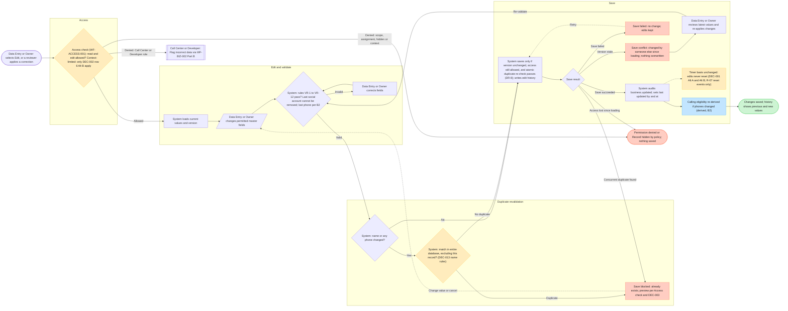

## WF-BIZ-002 Part B — Data-correction request submit and review (22 nodes)

```mermaid
flowchart LR
    s1(["Call Center, Developer or Owner selects Flag incorrect data in an authorized workspace"])
    subgraph subP ["Submit"]
        sAcc{"Access check (WF-ACCESS-001): requester passes for this business?"}
        sEnter[/"Requester picks field or issue, explains, optionally suggests a value"/]
        sValid{"System: issue type and explanation present?"}
        sFix["Requester completes the request"]
        sSave["System saves request as Submitted; business shows needs correction (derived)"]
        sNotify["Notify reviewers: data-correction request (recipients and timing: no DEC ID)"]
    end
    sDen(["Permission denied or hidden; no request created"])
    wEnd(["Withdrawn by requester (proposed)"])
    subgraph revP ["Review: shared queue (proposed)"]
        rQueue["Data Entry or Owner opens the correction queue"]
        rAcc{"Access check: reviewer passes for the business? (DEC-002 row 6)"}
        rOwner["Row 6 Alt A, business hidden from Data Entry: only the Owner can review"]
        rClaim["Reviewer starts review: request In review"]
        rVerify["Reviewer verifies the information"]
        rDecide{"Reviewer decision"}
    end
    subgraph resP ["Resolution"]
        rApply[["Apply via WF-BIZ-002 Part A: validation, duplicate re-check, atomic re-check, version check"]]
        rRes{"Edit save result"}
        rStay["Request stays In review: duplicate, invalid, conflict or save failure"]
        rResolved(["Resolved: changes applied; requester informed"])
        rNoChange(["Closed, no change needed (proposed); requester informed"])
        rReject["Reviewer records the rejection reason"]
        rRejected(["Rejected (request); requester informed"])
    end
    s1 --> sAcc
    sAcc -->|"Denied"| sDen
    sAcc -->|"Allowed"| sEnter
    sEnter --> sValid
    sValid -->|"Incomplete"| sFix
    sFix --> sValid
    sValid -->|"Complete"| sSave
    sSave -.-> sNotify
    sSave -.->|"Requester withdraws before resolution"| wEnd
    sSave --> rQueue
    rQueue --> rAcc
    rAcc -->|"Allowed, incl. row 6 Alt B"| rClaim
    rAcc -->|"Hidden from Data Entry"| rOwner
    rOwner --> rClaim
    rClaim -.->|"Release (proposed)"| rQueue
    rClaim --> rVerify
    rVerify --> rDecide
    rDecide -->|"Apply changes"| rApply
    rDecide -->|"Already correct or fixed"| rNoChange
    rDecide -->|"Request incorrect"| rReject
    rReject --> rRejected
    rApply --> rRes
    rRes -->|"Save succeeded"| rResolved
    rRes -->|"Blocked or failed"| rStay
    rStay -.->|"Revise or decide again"| rDecide
    classDef dec fill:#FFECBD,stroke:#FFC943,color:#1E1E1E
    classDef alt fill:#FFE0C2,stroke:#FF9E42,color:#1E1E1E
    classDef fail fill:#FFCDC2,stroke:#FF7556,color:#1E1E1E
    classDef ok fill:#CDF4D3,stroke:#66D575,color:#1E1E1E
    classDef derived fill:#C2E5FF,stroke:#3DADFF,color:#1E1E1E
    class sNotify,rAcc dec
    class rOwner alt
    class sDen,rStay,rRejected fail
    class rResolved,rNoChange ok
```

## WF-BIZ-003 — Category management (23 nodes)

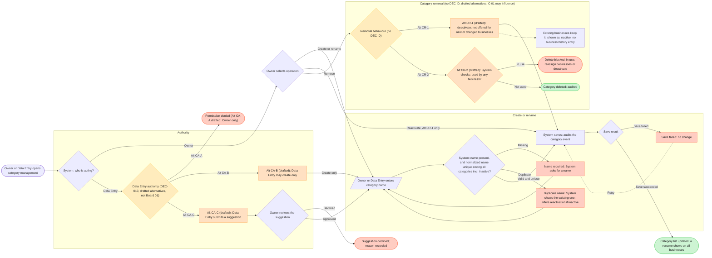

## WF-ACCESS-001 Part 1 — Search, lists, detail, direct URL, edit history (21 nodes)

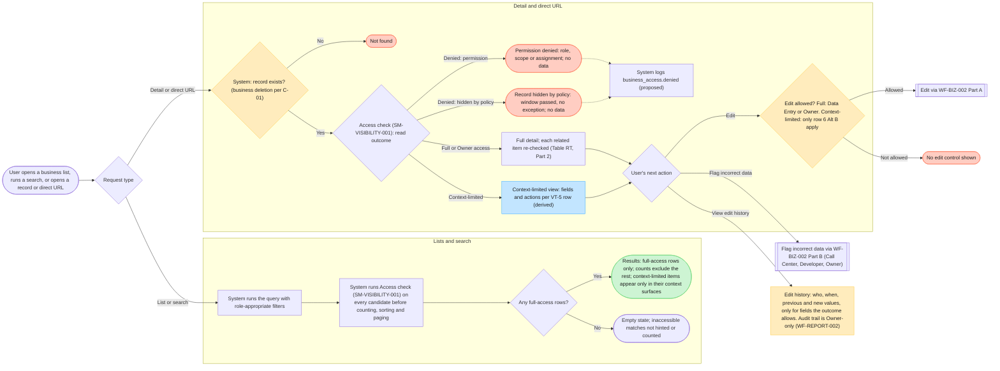

## WF-ACCESS-001 Part 2 — Related records and Developer deal/project lists (12 nodes)

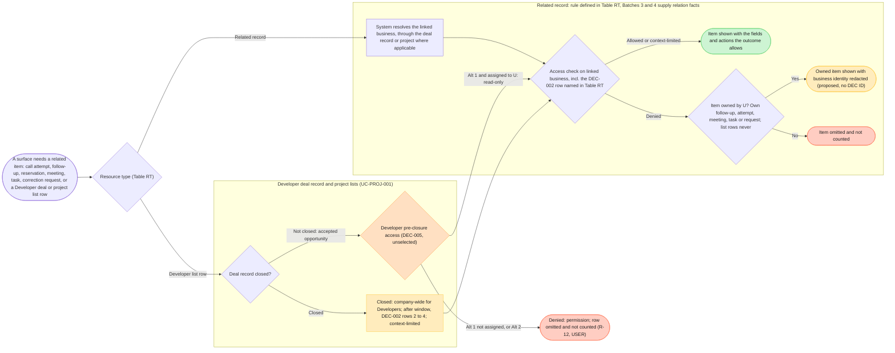

## WF-ACCESS-001 Part 3 — Calling actions (B7), notifications, exports, duplicate previews (20 nodes)

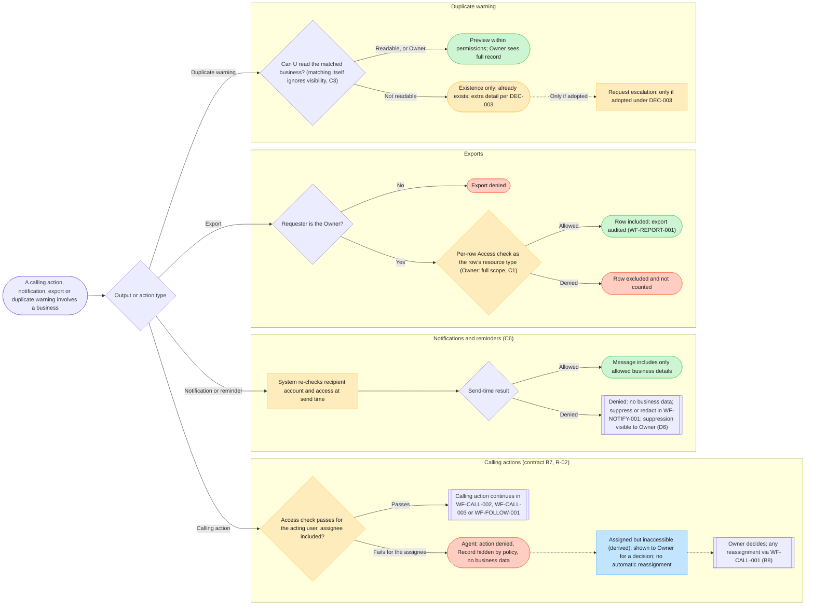

Note (WF-ACCESS-001 Part 2, as drawn): `deny005` sits outside the `devP` subgraph so its edge label does not overlap the node (board repair, layout only).

Note: the B7 path carries no "fails for a non-assignee" branch on purpose: a non-assignee is denied earlier by SM-VISIBILITY-001 step 6 and never reaches the B7 classification.

## SM-VISIBILITY-001 Part 1 — Evaluation steps 1 to 6, incl. R-11 readings (18 nodes)

Decision flow, not a state machine (no stored states), hence `flowchart LR`.

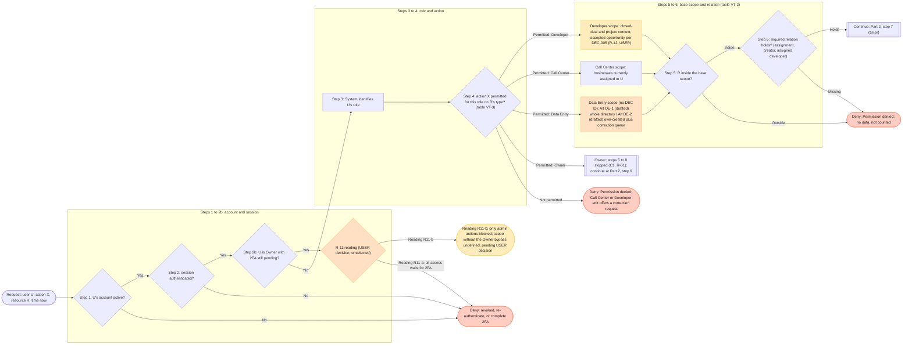

Note: step 3 only identifies the role; role routing is drawn on the step 4 edges so the Owner still passes step 4 (business deletion stays under C-01) before skipping steps 5–8 (R-01). Administrative access before 2FA is denied under both readings [Confirmed]; R-11 concerns everything else.

## SM-VISIBILITY-001 Part 2 — Evaluation steps 7 to 10 (21 nodes)

```mermaid
flowchart LR
    inN(["From Part 1: steps 1 to 6 passed (non-owner)"])
    inO(["From Part 1: Owner, steps 5 to 8 skipped (R-01)"])
    subgraph timerP ["Step 7: 15-day window (DEC-001, unselected)"]
        basis{"Timer basis (DEC-001)"}
        altA["Alt A: 15 days from business creation; no reset"]
        altB["Alt B: 15 days from creation, then from latest call_attempt.logged or follow_up.scheduled (R-07); edits, notes, status tweaks never reset"]
        within{"Now within 15 days of the selected basis?"}
    end
    subgraph excP ["Step 8: active-work exceptions for U (DEC-002, every row unselected)"]
        e1["Row 1 accepted opportunity: Alt A hidden unless extended / Alt B assigned Developer and Call Center"]
        e2["Row 2 closed deal: Alt A hidden unless extended / Alt B Developers company-wide, closed list only"]
        e3["Row 3 active project: Alt A hidden unless extended / Alt B project board until completion"]
        e4["Row 4 completed project: Alt A hidden / Alt B hidden 15 days after delivery"]
        e5["Row 5 scheduled callback: Alt A hidden / Alt B until callback plus 48 h"]
        e6["Row 6 open correction request: Alt A hidden / Alt B Data Entry, in queue, until resolved"]
        excRes{"Does any row, under its selected alternative, grant U access now?"}
    end
    hiddenCls["Hidden for U (derived); record still stored and duplicate-checked"]
    denyHidden(["Deny: Record hidden by policy; omitted and not counted in lists"])
    subgraph stateP ["Steps 9 to 10: resource state and outcome"]
        stChk{"Step 9: current resource state allows X? (C-01 archived or deleted, terminal request, Rejected is do-not-call)"}
        via{"Access granted through"}
    end
    denyState(["Deny, or read-only in this state"])
    full(["Full access for X"])
    limited(["Context-limited access: fields and actions per VT-5 row"])
    owner(["Owner access; audited (C1)"])
    inN --> basis
    basis -->|"Alt A"| altA
    basis -->|"Alt B"| altB
    altA --> within
    altB --> within
    within -->|"Yes"| stChk
    within -->|"No"| e1
    e1 --> e2
    e2 --> e3
    e3 --> e4
    e4 --> e5
    e5 --> e6
    e6 --> excRes
    excRes -->|"No"| hiddenCls
    hiddenCls --> denyHidden
    excRes -->|"Yes"| stChk
    inO --> stChk
    stChk -->|"Not allowed"| denyState
    stChk -->|"Allowed"| via
    via -->|"Window, step 7"| full
    via -->|"Exception, step 8"| limited
    via -->|"Owner"| owner
    classDef dec fill:#FFECBD,stroke:#FFC943,color:#1E1E1E
    classDef alt fill:#FFE0C2,stroke:#FF9E42,color:#1E1E1E
    classDef fail fill:#FFCDC2,stroke:#FF7556,color:#1E1E1E
    classDef ok fill:#CDF4D3,stroke:#66D575,color:#1E1E1E
    classDef derived fill:#C2E5FF,stroke:#3DADFF,color:#1E1E1E
    class basis,excRes,stChk dec
    class altA,altB,e1,e2,e3,e4,e5,e6 alt
    class hiddenCls derived
    class denyHidden,denyState fail
    class full,limited,owner ok
```

## SM-DATAFIX-001 — Data-correction request lifecycle (6 states, all Proposed)

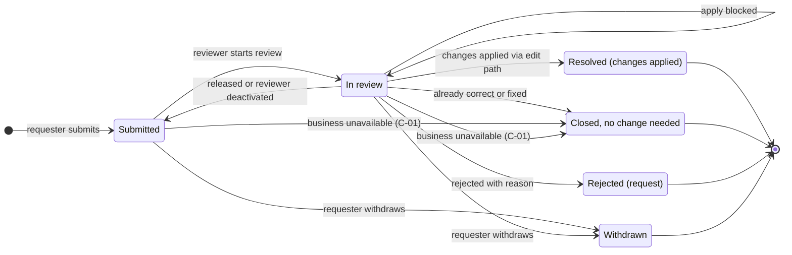

Header meta (T2c): "All states Proposed (ART-01 §14); C-01 transitions policy-dependent; 'Rejected (request)' is not the calling outcome Rejected". No notes or styling inside the state diagram (SB-2 §7).
