# Phase 2 Batch 3 — Mermaid source (DRAFT, repaired after review)

- **Status:** DRAFT by Agent 3. Repaired for RV3-01..11 (`repair-log.md`). Not approved. **Baseline: SB-2.**
- **Spec:** `batch3-spec.md` (same folder). Each diagram's header names its spec section.
- **Board:** this is the source sent to `generate_diagram` for Board 02 sections 06 (`65:3584`) and 07 (`65:3587`). Node IDs and inspection results are in `verification.md`. Any drawing-time change is listed there.
- **Layout rules applied (SB-2 §7):**
  - `flowchart LR` with phase subgraphs, not role swimlanes, and the actor named inside each step.
  - Every decision edge is labelled.
  - At most 25 nodes per diagram.
  - Colours come from `classDef` in flowcharts only, as in Batch 2.
  - State diagrams use `stateDiagram-v2` with no `note`, no `classDef` and no `style`.
  - No semicolons in labels or subgraph titles (the `generate_diagram` parser rejected them in Batch 2).
  - No node ID equals a classDef name.
- **Colour classes (SB-2 notation):**
  - `dec` yellow: Unresolved/Proposed dependency.
  - `alt` orange: unselected alternative.
  - `fail` red: failure or denial.
  - `ok` green: success end.
  - `derived` blue: derived classification.
  - Dotted edges mean retry or side effect. `[[...]]` means hand-off.
  - Drafted alternatives not on Board 01 are marked "no DEC ID".

---

## WF-CALL-001 Part 1 — Assignment and reassignment (spec §2.1)
Nodes: 25.
```mermaid
flowchart LR
    start(["Owner selects businesses and target agent"])
    wwStart[["WF-WORK-001 hand-off: new assignment or reassignment (B8)"]]
    b7Start(["Owner decides on assigned-but-inaccessible item (B7, from Part 2)"])
    autoStart(["System proposes allocation (DEC-021, proposed), Owner reviews"])
    authz{"Owner with completed 2FA and Access check passed (WF-ACCESS-001)?"}
    denied(["Permission denied"])
    subgraph elig ["Eligibility (contract B)"]
        bizOk{"Business eligible? Not Rejected, phone (proposed), not archived (C-01), open deal (DEC-017)"}
        excluded["System excludes item and shows reason"]
        agentOk{"Assignee is an active Call Center agent?"}
        fixAgent["Owner picks another agent"]
    end
    current{"Business currently assigned?"}
    subgraph reassign ["Reassignment impact (UC-CALL-008)"]
        impact["System shows open follow-ups and active reservation"]
        resv{"Active contact reservation?"}
        resvChoice{"Owner choice"}
        wait(["Not saved: Owner waits for release or expiry"])
        override[["Owner override via WF-CALL-002 (proposed)"]]
        fuExist{"Open follow-ups?"}
        fuApply["Owner chooses per follow-up: transfer, cancel (D2 marker if last), or keep (orphaned unless a guard exception is adopted) - policy-dependent, no DEC ID"]
        reason[/"Owner enters reassignment reason (proposed)"/]
    end
    subgraph savePhase ["Save (only WF-CALL-001 writes assignments, B8)"]
        save["System saves assignment row (source manual, work list or automatic), ends previous row, outcome unchanged"]
        saved{"Save result"}
        err["Save failed or conflict: nothing changed"]
        audit["System records calling_assignment event"]
        notify[["Notify assignee via WF-NOTIFY-001 (timing unresolved)"]]
    end
    done(["Business appears in agent queue (Part 2)"])
    start --> authz
    wwStart --> authz
    b7Start --> authz
    autoStart --> authz
    authz -->|"Denied"| denied
    authz -->|"Authorized"| bizOk
    bizOk -->|"Not eligible"| excluded
    excluded -->|"Owner adjusts selection"| start
    bizOk -->|"Eligible"| agentOk
    agentOk -->|"No"| fixAgent
    fixAgent --> agentOk
    agentOk -->|"Yes"| current
    current -->|"No: unassigned"| save
    current -->|"Yes: reassignment"| impact
    impact --> resv
    resv -->|"Yes"| resvChoice
    resvChoice -->|"Wait"| wait
    resvChoice -->|"Override"| override
    override --> fuExist
    resv -->|"No"| fuExist
    fuExist -->|"Yes"| fuApply
    fuExist -->|"No"| reason
    fuApply --> reason
    reason --> save
    save --> saved
    saved -->|"Save failed"| err
    err -.->|"Retry"| save
    saved -->|"Save succeeded"| audit
    audit --> notify
    notify --> done
    classDef dec fill:#FFECBD,stroke:#FFC943,color:#1E1E1E
    classDef alt fill:#FFE0C2,stroke:#FF9E42,color:#1E1E1E
    classDef fail fill:#FFCDC2,stroke:#FF7556,color:#1E1E1E
    classDef ok fill:#CDF4D3,stroke:#66D575,color:#1E1E1E
    classDef derived fill:#C2E5FF,stroke:#3DADFF,color:#1E1E1E
    class autoStart,bizOk,fuApply,reason,b7Start dec
    class denied,excluded,err,wait fail
    class done ok
```

## WF-CALL-001 Part 2 — Calling queue access and B7 Owner decision (spec §2.1)
Nodes: 21.
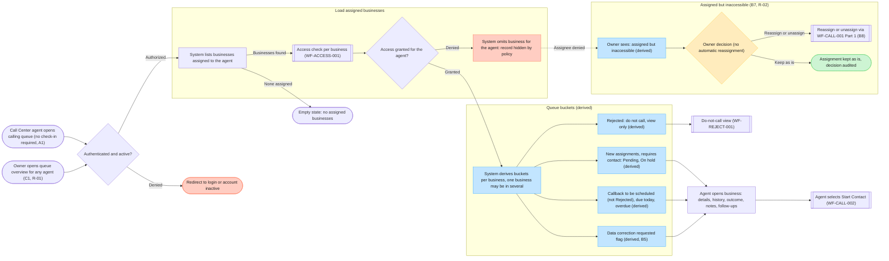

## WF-CALL-002 Part 1 — Start Contact: acquire, collision, renew (spec §2.2)
Nodes: 24.
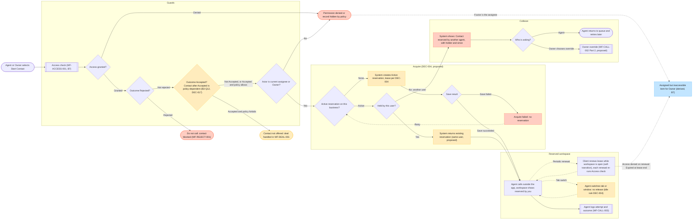

## WF-CALL-002 Part 2 — Release, expiry, network loss, stale client, override (spec §2.2)
Nodes: 24.
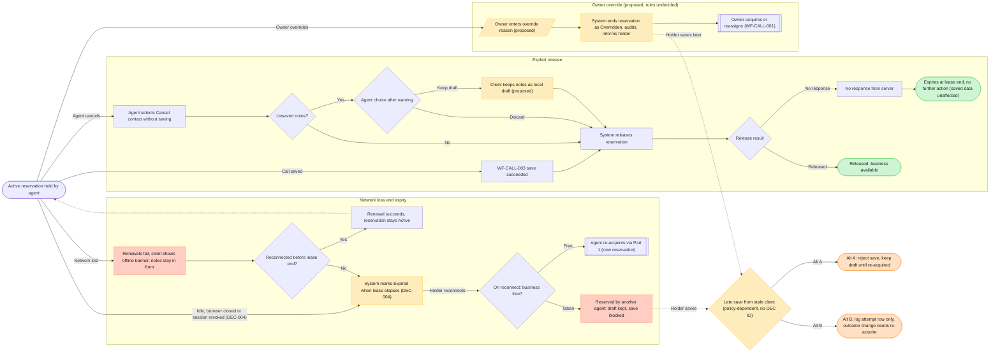

## WF-CALL-003 Part 1 — Attempt entry and outcome-specific fields (spec §2.3)
Nodes: 19.
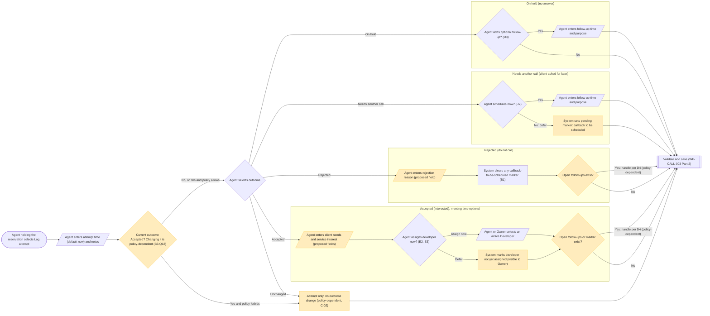

## WF-CALL-003 Part 2 — Validate, save, release, hand-offs (spec §2.3)
Nodes: 20.
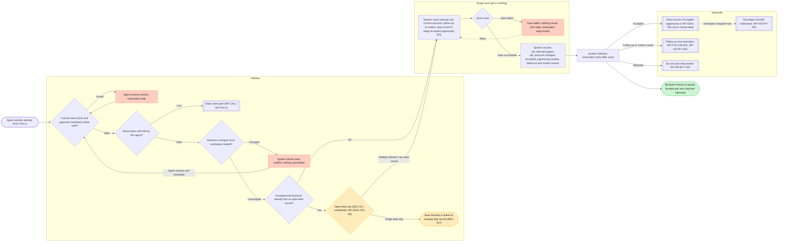

## WF-FOLLOW-001 — Follow-up schedule, reschedule, complete, cancel (spec §2.4)
Nodes: 22.
```mermaid
flowchart LR
    subgraph entry ["Entry points"]
        e1(["Follow-up created inside WF-CALL-003 save"])
        e2(["Agent schedules from queue: callback to be scheduled"])
        e3(["Agent or Owner opens an existing follow-up"])
    end
    authz{"Access check (WF-ACCESS-001, B7) passed and actor is responsible agent, assignee or Owner?"}
    denied(["Permission denied (B7 item for Owner if assignee)"])
    action{"Action chosen"}
    rejected{"Business outcome Rejected?"}
    dnc(["Blocked: do not call (WF-REJECT-001)"])
    subgraph sched ["Schedule or reschedule"]
        enter[/"Agent enters date, time (company timezone), purpose, and a reason if rescheduling"/]
        tValid{"Time valid? (future, proposed)"}
        fix["Agent corrects time"]
    end
    subgraph close ["Complete or cancel"]
        compl[/"Agent links call attempt or adds completion note"/]
        canc[/"Agent enters cancellation reason"/]
        lastFu{"Needs another call and last open follow-up closed without a linked call?"}
        repl["Agent adds replacement follow-up, or System sets callback-to-be-scheduled marker (D2), same save"]
    end
    save["System saves follow-up (history kept, marker cleared only when scheduling)"]
    saved{"Save result"}
    err["Save failed: no change"]
    audit["System records follow-up audit event"]
    remind[["Schedule, cancel or replace reminders via WF-NOTIFY-001 (failure never blocks follow-up, D5, D6)"]]
    show["Shown in dashboard, queue, calendar, Owner overview, due and overdue (derived)"]
    back(["Business returns to queue per current outcome"])
    e1 -->|"Already saved"| remind
    e2 --> authz
    e3 --> authz
    authz -->|"Denied"| denied
    authz -->|"Authorized"| action
    action -->|"Schedule or reschedule"| rejected
    action -->|"Complete"| compl
    action -->|"Cancel"| canc
    rejected -->|"Rejected"| dnc
    rejected -->|"Not rejected"| enter
    enter --> tValid
    tValid -->|"Invalid"| fix
    fix --> enter
    tValid -->|"Valid"| save
    compl --> lastFu
    canc --> lastFu
    lastFu -->|"Yes"| repl
    lastFu -->|"No"| save
    repl --> save
    save --> saved
    saved -->|"Save failed"| err
    err -.->|"Retry"| save
    saved -->|"Save succeeded"| audit
    audit --> remind
    remind --> show
    show -->|"Completed or cancelled"| back
    classDef dec fill:#FFECBD,stroke:#FFC943,color:#1E1E1E
    classDef alt fill:#FFE0C2,stroke:#FF9E42,color:#1E1E1E
    classDef fail fill:#FFCDC2,stroke:#FF7556,color:#1E1E1E
    classDef ok fill:#CDF4D3,stroke:#66D575,color:#1E1E1E
    classDef derived fill:#C2E5FF,stroke:#3DADFF,color:#1E1E1E
    class tValid,repl dec
    class denied,dnc,err fail
    class show derived
    class back ok
```

## WF-NOTIFY-001 Part 1 — Event intake: reminders and notifications (spec §2.5)
Nodes: 21.
```mermaid
flowchart LR
    subgraph sources ["Committed source events"]
        s1(["Follow-up scheduled, rescheduled, reassigned, completed, cancelled (WF-FOLLOW-001)"])
        s2(["Meeting scheduled, rescheduled, cancelled (WF-DEAL-001)"])
        s3(["Missing check-in or checkout flag (WF-ATT-003)"])
        s4(["New assignment, developer handoff, B7 item (WF-CALL-001, WF-CALL-003)"])
        s5(["Data or attendance correction submitted (WF-BIZ-002, WF-ATT-003)"])
    end
    committed{"Source save committed?"}
    none(["Nothing sent for unsaved changes"])
    family{"Delivery family (R-08)"}
    subgraph remPlan ["Reminder planning (SM-REMINDER-001), timing unresolved, no DEC ID"]
        kind{"Reminder change type"}
        cancelOld["System cancels pending reminders for this source"]
        cancelEnd(["Pending reminders Cancelled"])
        recip["System determines recipient (responsible user or attendees, proposed) and email channel"]
        timing["System computes trigger time from business event time (job time is not event time)"]
        past{"Trigger time already past?"}
        pastPol{"Short-notice rule (policy-dependent, no DEC ID)"}
        sched["System creates reminder instance: Scheduled"]
        schedOk{"Scheduling result"}
        schedErr["Scheduling failed: source unaffected, flagged and retried (proposed)"]
    end
    subgraph notPlan ["Notification (no state model, R-08)"]
        nRecip["System determines alert recipients and channel (unresolved, no DEC ID)"]
        nSend[["Send with Part 2 re-check and failure rules (C6, D6), events notification.sent, failed, suppressed"]]
    end
    dispatch[["Dispatch at trigger time (WF-NOTIFY-001 Part 2)"]]
    s1 --> committed
    s2 --> committed
    s3 --> committed
    s4 --> committed
    s5 --> committed
    committed -->|"No"| none
    committed -->|"Yes"| family
    family -->|"Follow-up or meeting: reminder"| kind
    family -->|"Other alert: notification"| nRecip
    nRecip --> nSend
    kind -->|"New"| recip
    kind -->|"Rescheduled or responsible user changed"| cancelOld
    kind -->|"Completed or cancelled"| cancelOld
    cancelOld -->|"Completed or cancelled"| cancelEnd
    cancelOld -->|"Rescheduled or recipient changed: plan new"| recip
    recip --> timing
    timing --> past
    past -->|"No"| sched
    past -->|"Yes"| pastPol
    pastPol -->|"Send now"| sched
    pastPol -->|"Skip"| cancelEnd
    sched --> schedOk
    schedOk -->|"Failed"| schedErr
    schedErr -.->|"Retry"| sched
    schedOk -->|"Scheduled"| dispatch
    classDef dec fill:#FFECBD,stroke:#FFC943,color:#1E1E1E
    classDef alt fill:#FFE0C2,stroke:#FF9E42,color:#1E1E1E
    classDef fail fill:#FFCDC2,stroke:#FF7556,color:#1E1E1E
    classDef ok fill:#CDF4D3,stroke:#66D575,color:#1E1E1E
    classDef derived fill:#C2E5FF,stroke:#3DADFF,color:#1E1E1E
    class recip,timing,pastPol,nRecip dec
    class schedErr fail
```

## WF-NOTIFY-001 Part 2 — Dispatch, re-check, failure, retry (spec §2.5)
Nodes: 19.
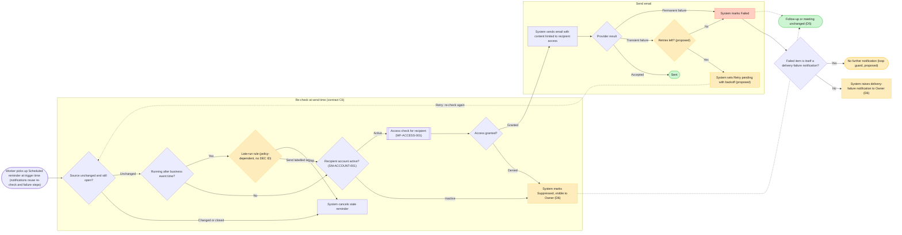

## WF-REJECT-001 — Do-not-call enforcement and controlled reopening (spec §2.6)
Nodes: 21.
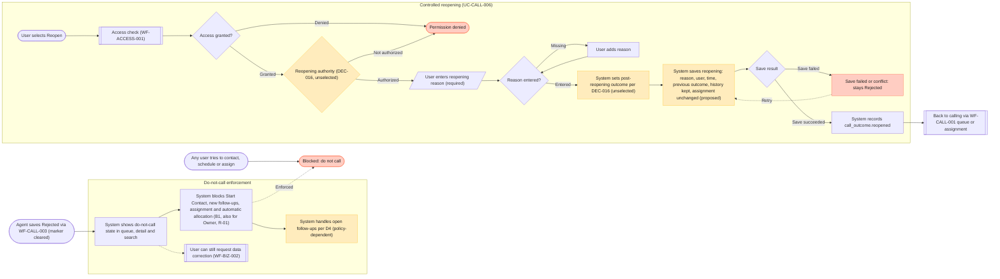

---

## SM-ASSIGNMENT-001 (spec §3.1)
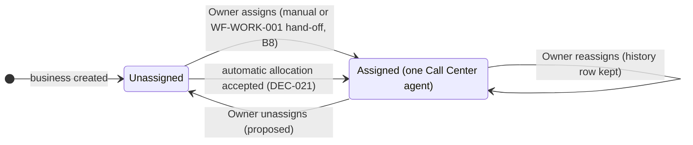

## SM-RESERVATION-001 (spec §3.2)
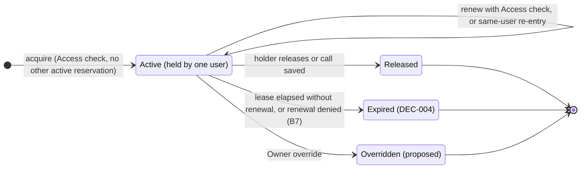

## SM-FOLLOWUP-001 (spec §3.3)
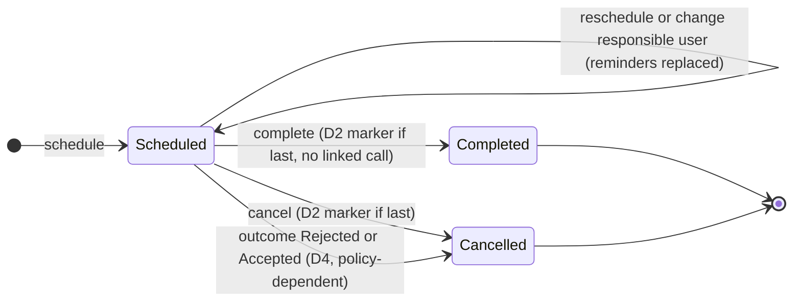

## SM-REMINDER-001 (spec §3.4) — follow-up and meeting reminders only (R-08)
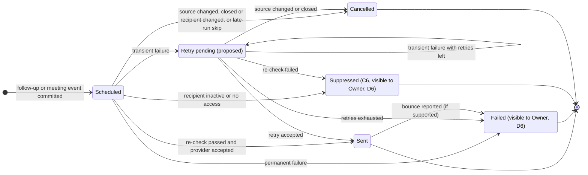

---

## Drawing-time source changes (T3d step 2; see `verification.md`)

- **SM-RESERVATION-001** was drawn as v3 with the flowchart source below instead of `stateDiagram-v2`. The `stateDiagram-v2` render hid the Active self-transition and put labels over the state names. Transitions and labels are unchanged except one, shortened from "lease elapsed without renewal, or renewal denied (B7)" to "lease elapsed, or renewal denied (B7)".
- **The flowchart re-render did not fix the problem either:** the self-loop is still not drawn. After two repair attempts the issue is recorded as residual.
- **SM-ASSIGNMENT-001, SM-FOLLOWUP-001 and SM-REMINDER-001** stay as drawn from the `stateDiagram-v2` source above. Each carries a "Reading note (render limitation)" text on the board that lists the undrawn self-transitions. The transition tables are authoritative.

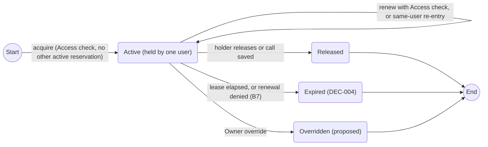
