# Phase 2 Batch 4 — Draft Mermaid source (NOT DRAWN)

Author: Agent 4. Baseline SB-2. Status: **DRAFT, repaired after review (RV4-01..06, see `repair-log.md`). Drawn on Board 02 sections 01, 08, 09 and 10 (see `verification.md`).** Specifications: `batch4-spec.md`.

Layout rules applied (SB-1 §7): `flowchart LR`; phase subgraphs (no role lanes); the actor is named inside each step; every decision edge is labelled; ≤ ~25 nodes per diagram (split into parts); dotted = retry or side effect; `[[...]]` = hand-off. State diagrams use `stateDiagram-v2` with no `note`, `classDef` or `style`.

As in Batch 1, colour lines are omitted from the source. Each diagram lists its **colour map** (node ids) per the SB-1 notation: Yellow = Unresolved/Proposed dependency; Orange = unselected alternatives; Red = failure; Green = success end; Blue = derived.

**Board send record (T4d).** Each flowchart was sent with `classDef`/`class`/`style` lines that follow its colour map (phase subgraphs tinted grey `#F5F5F5`, or light yellow/orange where the whole phase is policy-dependent). State diagrams were sent without styling. Small label changes made at send time:
- #1: `createRec` says "(E5)"; `alt2` adds "(R-12 → USER)".
- #2: `happened` reads "Developer, Owner or attending Call Center agent records outcome".
- #3: `denied` uses "x" instead of "×".
- #4: "§12" was sent as "s12" to keep the characters safe; `pending` adds "(F3)".
- #5: added the edge `openProj -->|"Owner updates"| action`; `action`, `sched` and `status` name "Developer or Owner" / "Actor".
- #17, #19, #21: simplified as shown below. Self-transitions and correction edges moved into the transition tables on the board.

| # | Diagram | Nodes | Status |
|---|---|---|---|
| 1 | WF-DEAL-001 Part 1 — Handoff and developer assignment | 22 | Draft |
| 2 | WF-DEAL-001 Part 2 — Meetings and discovery | 22 | Draft |
| 3 | WF-DEAL-002 Part 1 — Signature and payment | 20 | Draft |
| 4 | WF-DEAL-002 Part 2 — Closure and provisioning | 21 | Draft |
| 5 | WF-PROJ-001 Part 1 — Delivery list, assignment, schedule, status | 23 | Draft |
| 6 | WF-PROJ-001 Part 2 — Tasks and milestones | 18 | Draft |
| 7 | WF-AUTH-001 Part 1 — Login and Owner 2FA | 19 | Draft |
| 8 | WF-AUTH-001 Part 2 — Logout, expiry, revocation | 15 | Draft |
| 9 | WF-AUTH-002 Part 1 — Password reset | 22 | Draft |
| 10 | WF-AUTH-002 Part 2 — Owner 2FA enrollment and recovery | 16 | Draft |
| 11 | WF-EMP-001 Part 1 — Create, edit, role change | 22 | Draft |
| 12 | WF-EMP-001 Part 2 — Deactivation | 20 | Draft |
| 13 | WF-EMP-001 Part 3 — Self-profile update | 12 | Draft |
| 14 | WF-REPORT-001 Part 1 — Dashboard, filters, comparison | 20 | Draft |
| 15 | WF-REPORT-001 Part 2 — Export | 15 | Draft |
| 16 | WF-REPORT-002 — Audit log explorer | 15 | Draft |
| 17–22 | SM-COMMERCIAL-001, SM-MEETING-001, SM-PROJECT-001, SM-TASK-001, SM-ACCOUNT-001, SM-SESSION-001 | — | Draft |

---

## 1. WF-DEAL-001 Part 1 — Handoff and developer assignment
Colour map: Yellow `openDeal`, `multi`, `createRec`, `deferred`(also Blue), `notify`; Orange `access`, `alt1`, `alt2`, `existing`; Red `saveErr`; Blue `deferred`.
```mermaid
flowchart LR
    start(["Call Center agent finalizes Accepted in WF-CALL-003"])
    reopen(["Call Center agent or Owner opens deal record at any non-terminal stage to assign or reassign"])
    subgraph create ["Create accepted opportunity"]
        openDeal{"Business already has an open deal record? (DEC-017)"}
        multi{"Multiple concurrent deals allowed? (DEC-017, unresolved)"}
        existing(["Single only: existing deal record shown; no new record"])
        createRec["System creates deal record at Accepted opportunity in the same save as the outcome (proposed)"]
        saved{"Save result"}
        saveErr["Save failed: outcome and deal record unchanged"]
    end
    subgraph handoff ["Handoff context"]
        capture[/"Call Center agent captures client needs and service interest; call notes linked"/]
        contact["System shows business contact info subject to Access check (WF-ACCESS-001)"]
    end
    subgraph assign ["Developer assignment"]
        assignNow{"Call Center agent or Owner assigns a Developer now?"}
        deferred["Developer not yet assigned (derived), visible to Owner (E3, proposed)"]
        pickDev[/"Call Center agent or Owner selects Developer"/]
        devValid{"Active Developer?"}
        fixDev["Actor chooses another Developer"]
        saveAssign["System saves assignment with history; audit"]
        notify["System emits developer handoff event (timing unresolved)"]
        access{"Developer pre-closure access (DEC-005, unselected)"}
        alt1["Alt 1: assigned Developer gets scoping access"]
        alt2["Alt 2: Developer sees the deal only after closure"]
    end
    meet[["Meetings and discovery: WF-DEAL-001 Part 2"]]
    notifyWF[["Dispatch via WF-NOTIFY-001"]]
    start --> openDeal
    openDeal -->|"No"| createRec
    openDeal -->|"Yes"| multi
    multi -->|"Multiple allowed"| createRec
    multi -->|"Single only"| existing
    createRec --> saved
    saved -->|"Save failed"| saveErr
    saveErr -.->|"Retry"| createRec
    saved -->|"Save succeeded"| capture
    capture --> contact
    contact --> assignNow
    assignNow -->|"Deferred"| deferred
    assignNow -->|"Assign now"| pickDev
    reopen --> pickDev
    deferred -.->|"Assign later"| reopen
    deferred --> meet
    pickDev --> devValid
    devValid -->|"Invalid"| fixDev
    fixDev --> pickDev
    devValid -->|"Valid"| saveAssign
    saveAssign --> notify
    notify -.-> notifyWF
    saveAssign --> access
    access -->|"Alt 1"| alt1
    access -->|"Alt 2"| alt2
    alt1 --> meet
    alt2 --> meet
```

## 2. WF-DEAL-001 Part 2 — Meetings and discovery
Colour map: Yellow `start` (DEC-005), `valid`, `missed`; Red `denied`, `err`; Green `later`, `cancelled`; Blue `noMeet`.
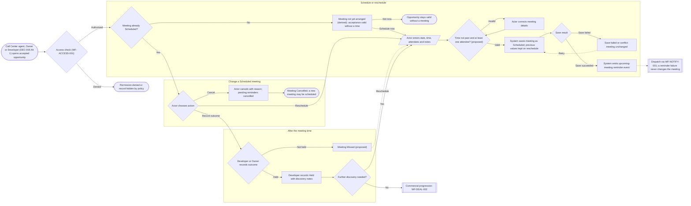

## 3. WF-DEAL-002 Part 1 — Signature and payment
Colour map: Yellow `facts` subgraph title (stage names proposed), `payDef`, `noAttach`, `lost`, `lostDone`, `remove`; Red `denied`, `err`.
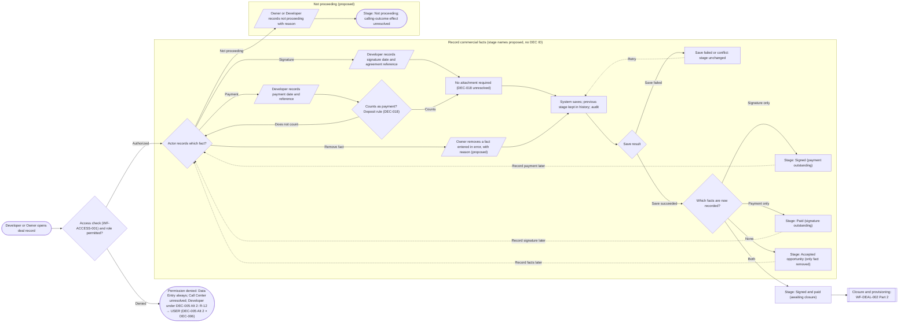

## 4. WF-DEAL-002 Part 2 — Closure and provisioning
Colour map: Orange `auth`, `altA`, `altB`, `mode`, `autoP`, `manual`; Yellow `review`, `ownerDec`; Red `reject`, `missing`, `err`, `pending`(also Blue); Blue `manual` text "(derived)", `pending`.
```mermaid
flowchart LR
    start(["Deal record at Signed and paid (awaiting closure)"])
    subgraph closure ["Closure authority (DEC-006, unselected)"]
        auth{"Which closure policy is adopted?"}
        altA[/"Alt A (drafted from ART-01 §12): Developer or Owner selects Finalize closure; Developer part R-12 → USER"/]
        altB[/"Alt B (drafted from ART-01 §12): Developer requests Owner verification"/]
        review["System raises Owner review item"]
        ownerDec{"Owner decision"}
        reject["Owner rejects with reason; stage unchanged"]
        ownerFin["Owner finalizes closure"]
    end
    subgraph finalize ["Finalize"]
        guard{"Accepted, signed and paid all recorded?"}
        missing["Blocked: missing fact named"]
        saveClose["System saves Closed deal with closer and time"]
        saved{"Save result"}
        err["Save failed: stays Signed and paid"]
        audit["System audits deal closed"]
    end
    subgraph prov ["Project provisioning (contract F2, unresolved)"]
        mode{"Which provisioning trigger is adopted?"}
        autoP["Alt Auto: System creates project board"]
        provOk{"Provisioning result"}
        pending["Project provisioning pending (derived); closure kept; Owner retries"]
        manual["Alt Manual: closed deal without project (derived) until Owner or Developer creates board"]
    end
    fix[["Correct facts via WF-DEAL-002 Part 1"]]
    proj[["Delivery: WF-PROJ-001"]]
    start --> auth
    auth -->|"Alt A"| altA
    auth -->|"Alt B"| altB
    altB --> review
    review --> ownerDec
    ownerDec -->|"Rejected"| reject
    reject -.-> fix
    ownerDec -->|"Verified"| ownerFin
    altA --> guard
    ownerFin --> guard
    guard -->|"No"| missing
    missing -.-> fix
    guard -->|"Yes"| saveClose
    saveClose --> saved
    saved -->|"Save failed"| err
    err -.->|"Retry"| saveClose
    saved -->|"Save succeeded"| audit
    audit --> mode
    mode -->|"Alt Auto"| autoP
    autoP --> provOk
    provOk -->|"Failed"| pending
    pending -.->|"Retry"| autoP
    provOk -->|"Succeeded"| proj
    mode -->|"Alt Manual"| manual
    manual -->|"Board created"| proj
```

## 5. WF-PROJ-001 Part 1 — Delivery list, assignment, schedule, status
Colour map: Yellow `updPolicy`, `upd` subgraph title (DEC-019), `warn`; Red `rejectT`, `err`; Green `done`, `none`(neutral end); Blue `mark`.
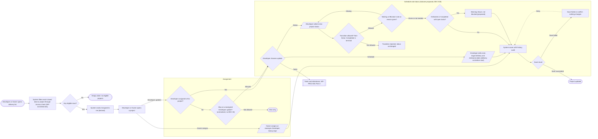

## 6. WF-PROJ-001 Part 2 — Tasks and milestones
Colour map: Yellow `status` (task statuses proposed), `count` (DEC-020), `milestone`; Red `denied`, `rej`, `err`; Green `fin`.
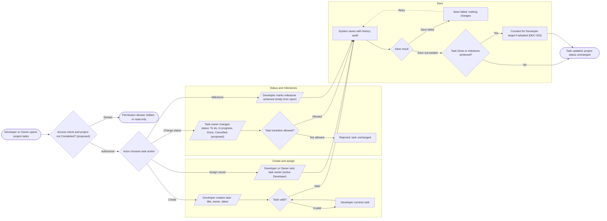

## 7. WF-AUTH-001 Part 1 — Login and Owner 2FA
Colour map: Yellow `throttle`, `twofa` subgraph title (method = implementation decision), `pendEnroll`, `pendVerify` (scope: R-11 → USER, both readings shown); Red `generic`, `inactive`, `ended`; Green `ws`.
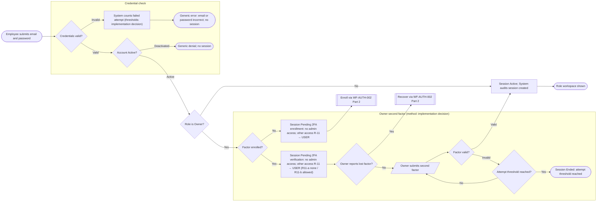

## 8. WF-AUTH-001 Part 2 — Logout, expiry, revocation
Colour map: Yellow `t2` (durations = implementation decision), `t3` (role change Proposed); Red `retry`; Green `loginPage`, `expiredMsg` (neutral ends).
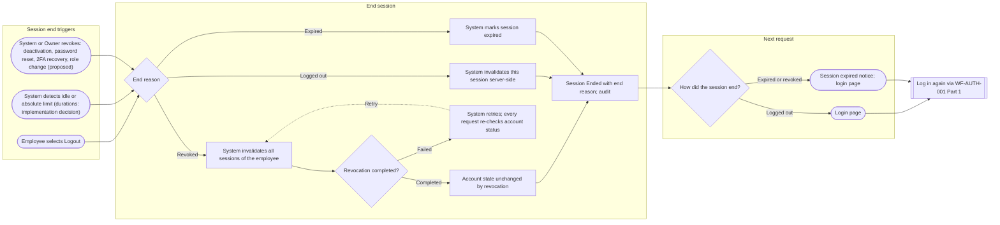

## 9. WF-AUTH-002 Part 1 — Password reset (self-service and Owner-triggered)
Colour map: Yellow `same`, `ownerDeact`, `token` (Proposed / implementation decision); Red `deniedO`, `failSeen`, `expired`, `err`; Green `login` hand-off.
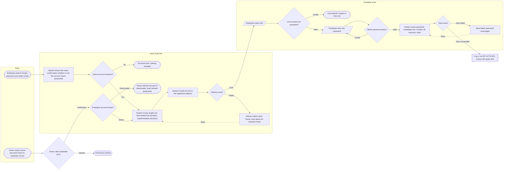

## 10. WF-AUTH-002 Part 2 — Owner 2FA enrollment (003A) and recovery (003B)
Colour map: Yellow `enrollPh` and `recoverPh` subgraph titles (method = implementation decision), `ops` (no DEC ID); Red `errE`, `recFail`, `endS`; Green `activeEnd`.
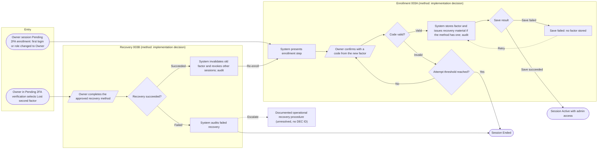

## 11. WF-EMP-001 Part 1 — Create, edit, role change
Colour map: Yellow `valid`, `guard`, `revoke`, `cred` (Proposed / implementation decision); Red `denied`, `blocked`, `err`; Green `doneAcct`; Blue `cred` text "(derived)".
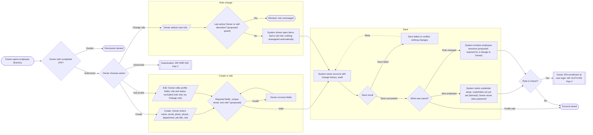

## 12. WF-EMP-001 Part 2 — Deactivation
Colour map: Yellow `guard`, `suppress` (Proposed); Red `denied`, `blocked`, `err`, `retry`; Green `cancelled`(neutral); Blue `flag`.
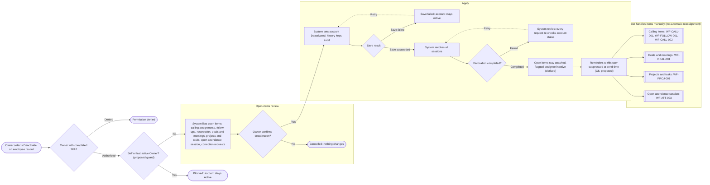

## 13. WF-EMP-001 Part 3 — Self-profile update (UC-AUTH-007)
Colour map: Yellow `editP`, `locked` (field set Proposed, OQ-13); Red `denied`, `err`; Green `doneP`.
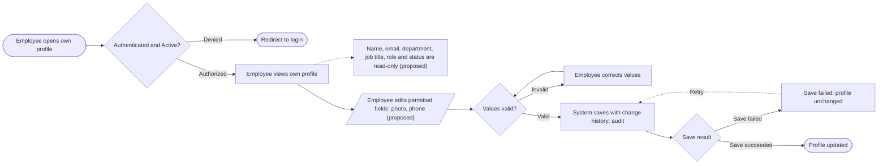

## 14. WF-REPORT-001 Part 1 — Dashboard, filters, period comparison
Colour map: Yellow `defined`, `pendingP` (DEC-007/008/020/022), `stock`, `na`; Red `denied`, `wErr`; Blue `query` note (G1 separate metrics).
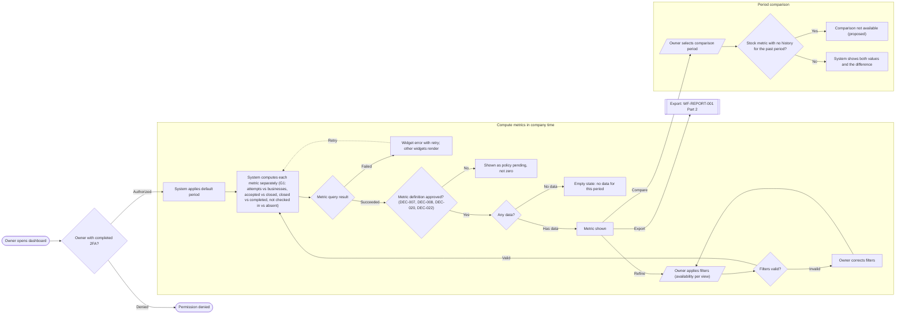

## 15. WF-REPORT-001 Part 2 — Export (XLS / CSV / PDF)
Colour map: Yellow `emptyFile`, `gen` (delivery mode = Phase 3 choice); Red `denied`, `auditDenied`, `fail`, `auditFail`; Green `file`.
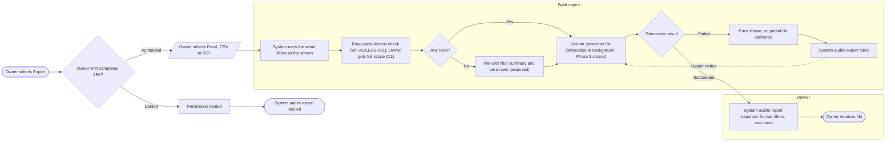

## 16. WF-REPORT-002 — Audit log explorer
Colour map: Yellow `auditD`, `modify` audit part (Proposed); Red `denied`, `err`, `modify`; Green `detail`.
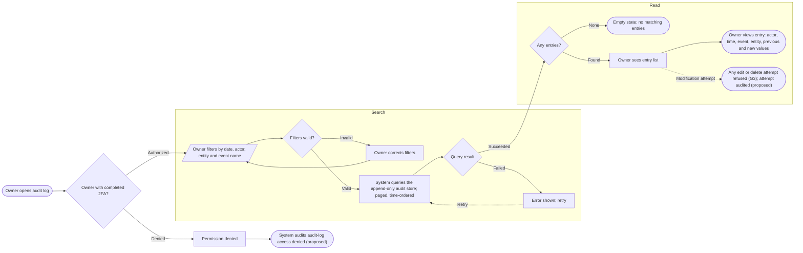

---

## 17. SM-COMMERCIAL-001 (all states and transitions Proposed; no DEC ID)
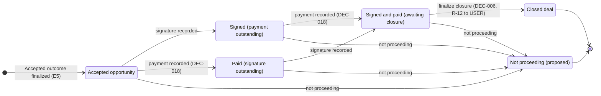

## 18. SM-MEETING-001 (states Proposed; "rescheduled" is an event)
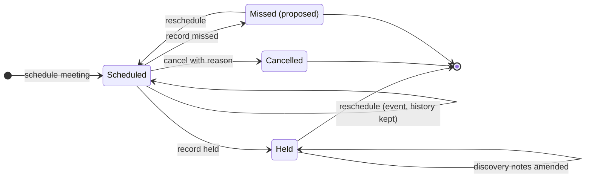

## 19. SM-PROJECT-001 (statuses Proposed, DEC-019; non-linear)
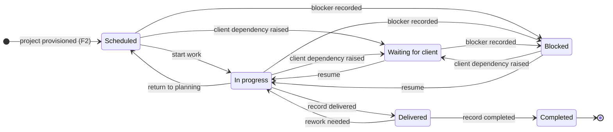

## 20. SM-TASK-001 (states Proposed; no DEC ID)
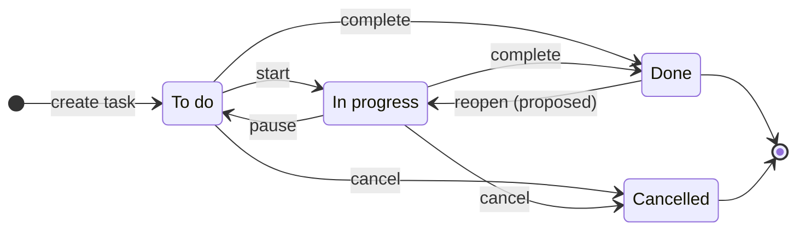

## 21. SM-ACCOUNT-001
```mermaid
stateDiagram-v2
    direction TB
    state "Active (self-events - profile edited, role changed)" as Active
    state "Deactivated (self-event - login attempt denied)" as Deactivated
    [*] --> Active: Owner creates employee
    Active --> Deactivated: Owner deactivates, sessions revoked
    Deactivated --> Active: Owner reactivates (proposed)
```

## 22. SM-SESSION-001
```mermaid
stateDiagram-v2
    direction LR
    state "Pending 2FA enrollment (restricted, scope R-11 → USER)" as PendEnroll
    state "Pending 2FA verification (restricted, scope R-11 → USER)" as PendVerify
    state "Active" as Active
    state "Ended" as Ended
    [*] --> Active: valid credentials, non-Owner
    [*] --> PendVerify: valid credentials, Owner with factor
    [*] --> PendEnroll: valid credentials, Owner without factor
    PendVerify --> PendVerify: invalid factor below threshold
    PendVerify --> Active: valid second factor
    PendVerify --> PendEnroll: recovery succeeded
    PendVerify --> Ended: threshold, timeout, logout or revocation
    PendEnroll --> Active: enrollment confirmed
    PendEnroll --> Ended: timeout, logout or revocation
    Active --> Active: activity renews idle timer
    Active --> Ended: logout, expiry or revocation
    Ended --> [*]
```
