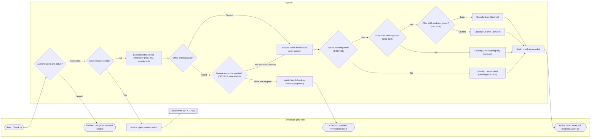
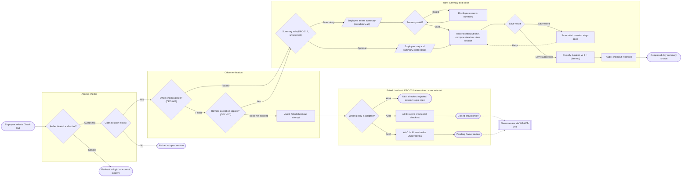
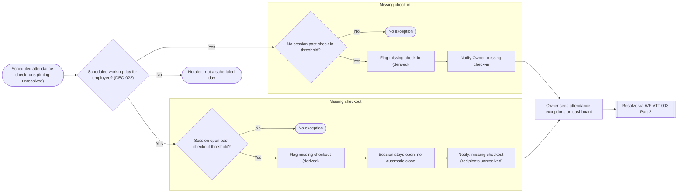
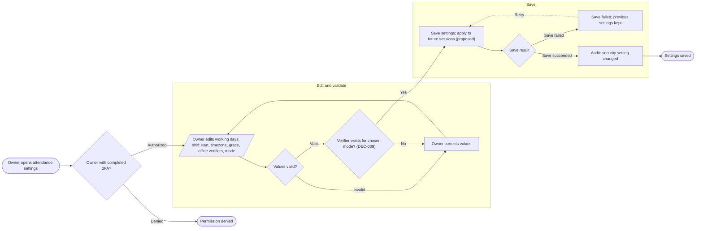
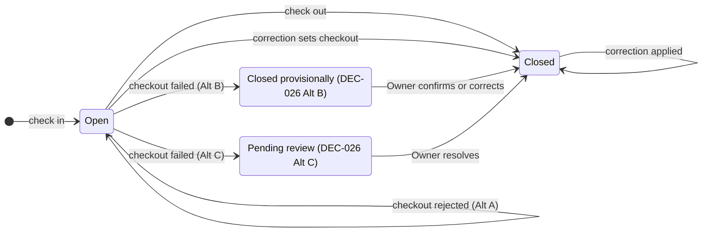
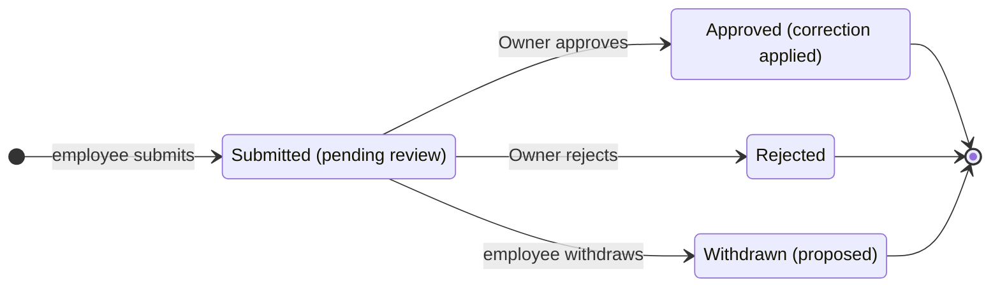

# Phase 2 Batch 1 — Diagram source

This is the Mermaid structure sent to `generate_diagram` for the **current** version of each diagram on Board 02 (`lwmKQNJI42na8B3SSNLQJP`). Nodes, edges and labels are exact. The colour lines (`classDef` / `class` / `style`) are omitted; they follow the legend in §8 of the Phase 2 doc. The board copies were then wrapped in sections and given header text with `use_figma`. Status: approved Phase 2 baseline (2026-10-20).

## WF-ATT-001 (v1) — node `11:721`

## WF-ATT-002 (v3) — node `21:1151`

## WF-ATT-003 Part 1 (v2) — node `25:1355`

## WF-ATT-003 Part 2 (v1) — node `11:724`

```mermaid
flowchart LR
    subgraph trig ["Triggers"]
        t1(["Check-in blocked by open session"])
        t2(["Missing-checkout flag"])
        t3(["Pending-review checkout (DEC-026 Alt C)"])
        t4(["Wrong time reported"])
    end
    authority{"Correction authority (DEC-011, unselected)"}
    subgraph altA ["Alt A: Owner-only adjustment"]
        aOpen["Owner opens session record"]
        aEnter[/"Owner enters corrected times and reason"/]
    end
    subgraph altB ["Alt B: Employee request, Owner review"]
        bEnter[/"Employee submits proposed times and reason"/]
        bValid{"Request complete?"}
        bFix["Employee completes request"]
        bPending["Request pending review"]
        bNotify["Notify Owner: correction awaiting review"]
        bDecide{"Owner decision"}
        bReject["Record rejection reason and audit"]
        rejDone(["Original stands; employee informed"])
    end
    subgraph apply ["System: apply correction"]
        validate{"Times valid? Order, no overlap, not future"}
        fixA["Owner corrects entry"]
        save["Save correction record; original kept"]
        saved{"Save result"}
        err["Show error; nothing changed"]
        audit["Audit: attendance corrected"]
        done(["Session closed or adjusted; check-in unblocked"])
    end
    t1 --> authority
    t2 --> authority
    t3 --> authority
    t4 --> authority
    authority -->|"Alt A"| aOpen
    aOpen --> aEnter
    aEnter --> validate
    authority -->|"Alt B"| bEnter
    bEnter --> bValid
    bValid -->|"Invalid"| bFix
    bFix --> bValid
    bValid -->|"Valid"| bPending
    bPending --> bNotify
    bNotify --> bDecide
    bDecide -->|"Rejected"| bReject
    bReject --> rejDone
    bDecide -->|"Approved"| validate
    validate -->|"Invalid"| fixA
    fixA --> validate
    validate -->|"Valid"| save
    save --> saved
    saved -->|"Save failed"| err
    err -.->|"Retry"| validate
    saved -->|"Save succeeded"| audit
    audit --> done
```

## WF-ADMIN-001 (v2) — node `27:1421`

## WF-WORK-001 (v3) — node `23:1283`

```mermaid
flowchart LR
    start(["Owner opens targets and work lists"])
    authz{"Owner authorized?"}
    denied(["Permission denied"])
    subgraph target ["Target setting"]
        pickEmp["Owner selects active employee and period"]
        setTarget[/"Owner sets metric and value (DEC-020, DEC-025)"/]
        tValid{"Target valid for role?"}
        fixT["Owner corrects target"]
        saveT["Save target; audit"]
    end
    method{"Work-list method"}
    subgraph manual ["Manual generation"]
        manualPick["Owner selects work items"]
        eligible{"Item eligible? Role, not rejected, in scope"}
        assignedElse{"Assigned to someone else?"}
    end
    reassign[["Reassign via WF-CALL-001"]]
    subgraph auto ["Automatic generation (DEC-021, unselected)"]
        autoRun["Owner runs automatic generation"]
        rule["System applies allocation rule"]
        enough{"Enough eligible items?"}
        shortfall["Shortfall shown to Owner"]
        preview["Owner reviews proposed allocation"]
        accept{"Accept allocation?"}
    end
    subgraph publish ["Save and publish"]
        saveW["Assign via WF-CALL-001 (contract B8); audit"]
        notify["Assignment notices sent by WF-CALL-001 (timing unresolved)"]
        progress["Count progress per DEC-020 (derived)"]
    end
    view(["Employee views target, completed, remaining, overdue"])
    start --> authz
    authz -->|"Denied"| denied
    authz -->|"Authorized"| pickEmp
    pickEmp --> setTarget
    setTarget --> tValid
    tValid -->|"Invalid"| fixT
    fixT --> tValid
    tValid -->|"Valid"| saveT
    saveT --> method
    method -->|"Target only"| progress
    method -->|"Manual"| manualPick
    method -->|"Automatic"| autoRun
    manualPick --> eligible
    eligible -->|"Not eligible"| manualPick
    eligible -->|"Eligible"| assignedElse
    assignedElse -->|"Yes"| reassign
    assignedElse -->|"No"| saveW
    autoRun --> rule
    rule --> enough
    enough -->|"No"| shortfall
    shortfall --> preview
    enough -->|"Yes"| preview
    preview --> accept
    accept -->|"No: adjust"| method
    accept -->|"Yes"| saveW
    saveW --> notify
    notify --> progress
    progress --> view
```

## SM-ATTENDANCE-001 — node `11:727`

## SM-CORRECTION-001 — node `11:728`

